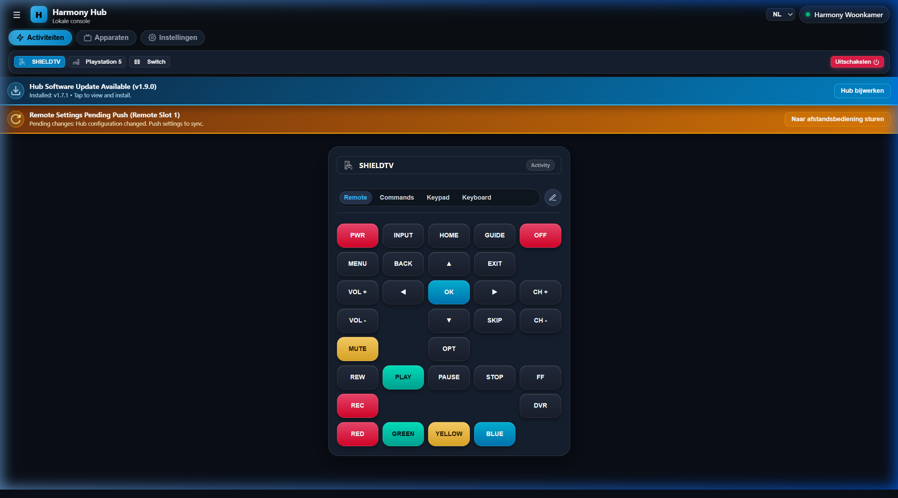
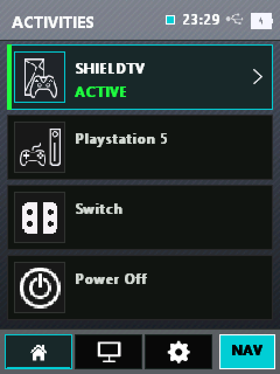

# HarmonyNG

Independent, open-source local control firmware and companion suite for the **Logitech Harmony Hub** and **Harmony Elite 950** handheld remote. Restores full universal remote and smart home functionality with zero cloud dependency after Logitech's end-of-life (EOL).

<div align="center">
  <table>
    <tr>
      <td width="65%" align="center">
        <b>Harmony Hub Web UI & Companion App</b><br>
        <i>Autonomous local control console (REST & WebSockets)</i><br><br>
        
      </td>
      <td width="35%" align="center">
        <b>Harmony Elite 950 Handheld Remote</b><br>
        <i>Real-time native framebuffer UI (240x320 RGB565)</i><br><br>
        
      </td>
    </tr>
  </table>
</div>

---

## 🚀 Quick Start & Installation

Setting up HarmonyNG takes just a few minutes. Pre-built release bundles containing all binaries, modules, scripts, and deployment tools are ready on the [**Releases Page**](https://github.com/iranl/harmony-ng/releases) — **no compilation required**.

| Target | Installation Guide | Requirements |
| :--- | :--- | :--- |
| **Harmony Hub** | [**Harmony Hub Installation Guide**](docs/FIRST_INSTALL_HUB.md) | Harmony Hub (Standard `046D:C129` or Pro 2400 `046D:C132`), Micro-USB cable, PC (Windows, macOS, or Linux) |
| **Harmony Elite & Pro Remote** | [**Harmony Elite Remote Installation Guide**](docs/FIRST_INSTALL_ELITE.md) | Harmony Elite 950 or Harmony Pro 2400 Remote (Skin 116), Micro-USB cable, PC *(Ultimate/Touch/Pro 2400 fully supported, untested on physical hardware)* |
| **Android Companion App** | [Download APK from Releases](https://github.com/iranl/harmony-ng/releases) | Android phone or tablet (Android 10+) |
| **Web UI** | Pre-installed on Hub at `http://<hub-ip>:8089` | Modern web browser |
| **Ethernet Setup** | [**Ethernet & Network Guide**](docs/ETHERNET_AND_NETWORK_SETUP.md) | Native onboard RJ45/PoE (Pro 2400) or OTG Micro-USB Ethernet Adapter (Standard Hub) |

---

## Architecture Overview

```
                      +-----------------------------------+
                      |   Client Application (SPA / App)  |
                      |  - Modern Vite + Vanilla JS + CSS |
                      |  - Android Capacitor Companion    |
                      +-----------------+-----------------+
                                        | HTTP REST & WebSockets
                                        v
+---------------------------------------+---------------------------------------+
|  Harmony Hub (Atheros AR9344 SoC - MIPS32 Linux)                              |
|                                                                               |
|  [hub_daemon] (Lean ~240KB Micro-Daemon)                                    |
|   ├── Non-blocking select() event loop (CPU < 2%, RAM < 8MB)                  |
|   ├── REST JSON API (/api/status, /api/inventory, /api/activities)            |
|   ├── WebSocket Server (/ws - live status & bidirectional button streaming)  |
|   ├── Activity Orchestrator (interlocks, start/stop step queues, delays)      |
|   └── Native Hardware Drivers:                                                |
|        ├── Direct I2S IR Engine (ir_i2s.c / ir_encoder.c - hardware pulsing)  |
|        ├── CC2544 RF SPI Engine (hub_rf.c - Mode 0 packet ack framing)     |
|        └── BTstack Bluetooth HID (hub_btstack - Apple TV, Shield, Fire TV)  |
+---------------------------------------+---------------------------------------+
                                        | 2.4GHz RF (Mode 1 / Report 0x20)
                                        v
+---------------------------------------+---------------------------------------+
|  Harmony Elite 950 Remote (Handheld Remote)                                   |
|   ├── Framebuffer graphics & touch UI (elite_ui.c)                          |
|   ├── Direct input event handling (/dev/input/event0)                          |
|   └── Low-power CC2544 RF transceiver (elite_rf.c)                          |
+-------------------------------------------------------------------------------+
```

---

## Subsystem & Feature Comparison (HarmonyNG vs. Stock Logitech Software)

The table below details every major functional component for both the **Harmony Hub** and **Harmony Elite 950**, comparing HarmonyNG with the original factory software stack:

### Harmony Hub

| Dimension | Stock Logitech Firmware | HarmonyNG Custom Firmware |
| :--- | :--- | :--- |
| **Cloud Dependency** | **100% Mandatory**: Requires Logitech AWS cloud servers for account authentication, provisioning, configuration sync, and unbricking. Bricked once servers go offline. | **0% Zero Cloud**: Fully autonomous local operation. No external servers, telemetry, or account sign-in required. Runs permanently offline. |
| **Core Architecture** | **Monolithic Lua Runtime**: `luaworks` and Lua 5.1/LuaJIT consuming 12–16 MB RAM and 15–30% CPU, guarded by an aggressive watchdog (`/usr/bin/watchdog`). | **Native C Micro-Daemon**: `hub_daemon` compiled for MIPS 24Kc (< 600 KB binary, < 2% CPU, < 8 MB RAM). Non-blocking `select()` event loop. |
| **Web & App Interface** | **Cloud-Mediated Mobile App**: iOS/Android app routes all initial discovery and setups through remote AWS endpoints. Local WebUI was completely removed in v4.x. | **Integrated Local WebUI & Android App**: Fast SPA served directly from the Hub flash (< 65 KB gzipped), with companion Capacitor Android app and live WebSocket streaming. |
| **Networking & Ethernet** | **Wi-Fi 2.4 GHz Only**: Restricted to 802.11b/g/n wireless. Micro-USB port locked to device gadget mode (USB serial / HID). No Ethernet support. | **Dual Network (Wi-Fi + Ethernet)**: Supports both **Harmony Hub Pro 2400** (native onboard Atheros GMAC `eth1` with PoE / RJ45 port; USB gadget mode remains fully active for PC control) and **Standard Harmony Hub** (dynamic USB Host mode activator switching on-chip Atheros EHCI controller to 480 Mbps host mode with Realtek RTL8152/8153, ASIX, SMSC, CDC-Ethernet dongles). Seamless link-state failover (Ethernet prioritized, Wi-Fi standby), unified static IP handover. See [Ethernet & Network Setup Guide](docs/ETHERNET_AND_NETWORK_SETUP.md). |
| **IR Transmission** | **HAL Subsystem**: Closed-source `hal` binary driving proprietary I2S kernel driver, restricted to fixed cloud database code sets. | **Direct I2S DMA Pulsing**: Clean-room hardware driver (`ir_i2s.c`) pulsing AR9344 I2S registers directly. Supports raw Pronto hex, NEC, RC5, RC6, Sony, Denon, and custom timings across Port 1, Port 2, or front blaster. |
| **Bluetooth Engine** | **BlueZ 4 Stack**: Legacy BlueZ daemon with heavy D-Bus overhead, prone to random disconnections and pairing drops. | **BlueKitchen BTstack**: Direct UART HCI transport (`/dev/ttyATH0`), persistent pairing table, media keys, and automated reconnect daemon (`bt_reconnect.sh`). |
| **RF Remote Engine** | **Proprietary eQuad Protocol**: Managed by `hal_hub` via `/dev/rfspi`. Locked to stock remote pairings and cloud IDs. | **Clean-Room CC2544 Driver**: Direct `/dev/rfspi` SPI Report `0x12` framing with ACK tracking, dynamic pairing, and instantaneous bidirectional synchronization with Elite remotes. |
| **Activity Orchestration** | **Rigid Cloud Sequences**: Static power macros compiled in the cloud. Out-of-sync devices require stepping through the mobile "Fix It" wizard. | **Stateful C Orchestrator**: `orchestrator.c` tracks discrete device power states, interlocks, step queues, and delays, with live WebSocket and MQTT progress feeds. |
| **Smart Home & Automation** | **Cloud Skill & Deprecated XMPP**: Local XMPP blocked in firmware v4.15.206. Cloud skills face deprecation. | **Native Bidirectional MQTT**: Built-in MQTT client with Home Assistant MQTT Auto-Discovery (`homeassistant/remote/` and `homeassistant/select/`). Full REST & WebSocket API. |
| **Flash & Safe Recovery** | **Flash Wear & Brick Risk**: Unmonitored writes to JFFS2 flash. Bricked units require factory wipe. | **RAM-Isolated & Panic Protected**: All runtime logs/PIDs in tmpfs (`/tmp`). Automatic reboot loop counter resets Hub into Safe Recovery mode if 5 boot crashes occur. |

### Harmony Elite 950 Handheld Remote

| Dimension | Stock Logitech Firmware | HarmonyNG Custom Firmware |
| :--- | :--- | :--- |
| **GUI & Display Engine** | **Monolithic Lua GUI**: `luadraws` + `luaworks` taking 30+ seconds to boot, heavy memory footprint, closed stock assets. | **Native Framebuffer GUI**: `elite_ui.c` rendering directly to `/dev/fb0` (240x320 16-bit RGB565) in under 2 seconds. TrueType vector typography via `stb_truetype`. |
| **Touch & Physical Controls** | **Vendor Input Handlers**: Custom event pipes dependent on stock daemons. | **Direct Linux Input Multiplexing**: Linux `/dev/input/event0` (touch digitizer) and `/dev/input/event1` (physical keypad) with auto-repeat and tactile haptic feedback. |
| **Hub Synchronization** | **Desktop USB Sync Required**: Updating button maps or activities required connecting the remote via USB to a PC running MyHarmony. | **Over-the-Air RF Sync**: Over-the-air synchronization over 2.4 GHz CC2544 RF using Report `0x20` protocol. Screen updates state immediately when an activity starts on WebUI or HA. |
| **Battery Life & Power Management** | **High Drain**: Accelerometer polled continuously at 50 Hz, unconfigurable button backlight draining battery in ~24–48 hours. | **Multi-Tier Power Optimization**: Configurable LIS3DH accelerometer rate (10/25/50 Hz, saving up to 60% standby power), night-mode button backlight scheduler, and configurable screen timeouts. |
| **Offline Autonomy** | **Hub-Dependent Lockout**: Shows a persistent spinning gear / connection error screen if Hub is out of range or offline. | **Autonomous Cached Operation**: Operates smoothly offline from cached device profiles and button maps, with on-screen diagnostic settings and pairing tools. |

---

## Known Regressions & Differences (Compared to Stock Logitech Software)

While HarmonyNG restores complete local independence and dramatically reduces memory and CPU usage, note the following differences from stock Logitech firmware:

1. **No Harmony Companion / Smart Control Remote Support (Yet)**:
   - Harmony Elite 950 handheld touchscreen remotes are fully supported via the CC2544 2.4GHz RF engine.
   - Harmony Ultimate (Home) and Harmony Touch **SHOULD** also be supported using the same tooling as Elite, but are currently untested, try at your own risk.
   - The button-only Harmony Companion and Smart Control remotes utilize a different RF pairing and payload handshake that is not yet implemented. Protocol contributions and pull requests are warmly welcomed!
   - **Physical Bluetooth BLE Remotes (e.g. Homatics B25)**: Fully supported via the Hub Bluetooth stack with per-activity button mapping in the Web UI. *Note: When a sleeping BLE remote is pressed, the first button press wakes the remote (showing a red light on the B25) and will drop; the second button press will register once the BLE remote finishes reconnecting to the Harmony Hub.*
2. **No Direct Local Network / IP Control (e.g. Roku ECP, Hue Direct, Sony IP)**:
   - Stock Logitech software relied on closed-source Lua plugins to control local IP devices. HarmonyNG focuses purely on native hardware-direct IR (I2S DMA register pulsing) and Bluetooth HID control.
   - **Mitigation via Home Assistant / MQTT**: This is easily mitigated by connecting HarmonyNG to **Home Assistant via the built-in bidirectional MQTT bridge**. Home Assistant natively supports thousands of IP-controlled devices (Roku, Apple TV, Philips Hue, Android TV) and can be triggered seamlessly by Harmony activities and remote button presses.

---

## Repository Structure

```text
.
├── android-app/            # Modern client SPA & Android Capacitor project
├── build/                  # Cross-compilation toolchains, build, and deploy scripts
│   ├── cc2544/             # GPLv2 kernel driver for CC2544 RF transceiver
│   ├── patches/            # BTstack patches
│   ├── build_apk.ps1       # Android APK build and package script
│   ├── build_btstack.sh    # MIPS32 BTstack cross-compilation script
│   ├── build_webui.ps1     # Frontend Vite builder and gzip compressor
│   ├── compile_all.sh      # Master Hub userspace binary build script
│   ├── deploy_hub.ps1      # Hub deployment script (PowerShell)
│   └── deploy_hub.sh       # Hub deployment script (Bash)
├── docs/                   # Technical documentation
│   ├── API.md              # Complete REST & WebSocket API specification
│   ├── BLUETOOTH_HID_CODES.md # Bluetooth HID keycodes and mappings
│   ├── ELITE.md            # Elite remote hardware, RF protocol, and display specs
│   ├── ELITE_BATTERY_OPTIMIZATION.md # Power management & battery life guide
│   ├── FIRST_INSTALL_HUB.md   # First-time installation and rooting guide for Hub
│   ├── FIRST_INSTALL_ELITE.md # First-time installation and setup guide for Elite
│   ├── HARMONY_RF_PROTOCOL.md # Reverse-engineered CC2544 2.4GHz RF protocol
│   └── OFFLINE_UNBRICK_AND_ROOT_GUIDE.md  # Recovery, UART, and SPI flash guide
├── elite/                  # Elite 950 remote userspace binaries and deployment tools
│   ├── bootstrap_serial.py # Hardware serial bootstrap
│   ├── deploy_elite.ps1    # Remote deployment script (PowerShell)
│   ├── deploy_elite.py     # Remote deployment script (Python)
│   ├── setup_remote.py     # Multi-step remote provisioning tool
│   └── rcS.local           # Elite safe-boot script with panic recovery
├── payload/
│   ├── bin/                # Target MIPS executables for Hub
│   ├── modules/            # USB Ethernet kernel drivers (r8152, asix, cdc_ether, etc.)
│   ├── scripts/            # Hub startup (init.sh), network manager, recovery AP
│   └── source/             # Clean-room native C source code
│       ├── hub_daemon.c  # Hub micro-daemon and master select() loop
│       ├── config_store.c  # Atomic JSON device/activity configuration store
│       ├── http_server.c   # Lightweight REST JSON API server
│       ├── ws_server.c     # RFC 6455 WebSocket server
│       ├── ir_i2s.c        # Direct AR9344 I2S hardware pulse transmitter
│       ├── ir_encoder.c    # Protocol bit encoders (NEC, RC5, RC6, Sony, Pronto)
│       ├── hub_rf.c      # CC2544 RF protocol engine
│       ├── hub_btstack/  # BTstack Bluetooth HID daemon integration
│       ├── elite_ui.c   # Elite framebuffer GUI & input application
│       ├── hub_dhcpd.c     # Clean-room RFC 2131 DHCP recovery server
│       └── hub_portal.c    # Wi-Fi recovery captive portal
└── tools/
    ├── factory_reset.py    # Clean revert tool to factory stock firmware
    ├── harmony_firmware.py # SUS firmware check, download, flasher & icon extractor
    ├── restore_stock.py    # All-in-one stock restore and configuration recovery tool
    ├── root_hub_usb.py     # USB HID root unlock tool with auto stock backup (.tar)
    └── unbrick_recovery/   # SPI flash and Dropbear emergency recovery tools
```

---

## Building from Source

Build requires Linux (or WSL2) with standard build utilities:

```bash
# 1. Compile Hub native binaries (MIPS32 big-endian)
./build/compile_all.sh all

# 2. Compile BTstack Bluetooth daemon
./build/build_btstack.sh

# 3. Build Web UI Client SPA
cd android-app
npm install
npm run build
```

---

## Extracting Official Remote UI Icons

The official Logitech Elite remote firmware contains 1,350 official UI icons (activity icons, command glyphs, power toggles, device branding). You can extract all stock icons directly from the official firmware bundle (`.hfw2` SquashFS filesystem) without needing an Elite remote connected over USB or transferring files over SSH.

### Automated Extraction During Hub Deployment
When running `./build/deploy_hub.ps1` or `./build/deploy_hub.sh`, the installer checks for `build/icons.tar.gz`. If missing, it automatically prompts to download official Elite firmware (`elite_99_4.15.330.hfw2`), extract all 1,350 icons, package them into `build/icons.tar.gz`, and stage them to `/cache/icons.tar.gz` on the Hub.

### Standalone Extraction Using Python
You can also extract icons or build the WebUI archive manually at any time on any platform (Windows, macOS, Linux):

```bash
# Extract all 1,350 official icons and build the Hub WebUI archive:
python tools/harmony_firmware.py extract-icons --archive build/icons.tar.gz

# Or extract raw PNG icons into a custom directory:
python tools/harmony_firmware.py extract-icons --out-dir payload/www/assets/icons
```

### How It Works
1. Downloads official Elite firmware bundle (`elite_99_4.15.330.hfw2`) from Logitech update servers (or uses cached copy).
2. Unpacks the internal SquashFS root filesystem using Python.
3. Indexes and extracts all 1,347+ PNG assets across `footer`, `hopsactivity`, `juniperactivity`, `commands`, `devices`, and `settings`.
4. Packages them into `build/icons.tar.gz`. On the Hub, the web daemon dynamically unpacks icons into `/tmp/www/assets/icons` on first request.

---

## Backup & Restoration Safety (No Gzip)

All Hub partition backups and stock configuration restores (`tools/root_hub_usb.py`, `tools/restore_stock.py`, `build/backup_hub.sh`) use **plain uncompressed tar archives** (`.tar`, not `.tar.gz`).

- **Why no gzip?** Embedded MIPS BusyBox has limited RAM and flash bandwidth. Streaming uncompressed tar avoids CPU exhaustion, reduces write cycles, and prevents out-of-memory kernel panics during recovery.
- **Stock Backup Location**: `backups/stock_hub_backup_<timestamp>.tar` (and `backups/stock_hub_backup_latest.tar`).
- **Restoration**: `python tools/restore_stock.py` restores `/cache` and `/data` cleanly and reboots into configured stock firmware.


---

## API Documentation & OpenAPI Specification

HarmonyNG exposes an extensive local REST and WebSocket API running on port `8089`.

- **Interactive Swagger UI (GitHub Pages)**: [https://iranl.github.io/harmony-ng/](https://iranl.github.io/harmony-ng/)
  - Features real-time **"Try it out"** testing against your local Harmony Hub (e.g. `http://<hub-ip>:8089` or `http://harmony.local:8089`).
- **OpenAPI 3.1 Spec**: [`docs/openapi.yaml`](docs/openapi.yaml)
- **HTTP & WebSocket API Specification**: [`docs/API.md`](docs/API.md)

---

## License & Legal Information

This project is licensed under the **MIT License** for all userspace code and the **GNU General Public License v2 (GPL-2.0)** for the Linux kernel transceiver driver (`build/cc2544/`). See [`LICENSE`](LICENSE) for complete terms.

### Attribution & Acknowledgments
This project was originally inspired by and based on the foundational research and repository created by [Ripthulhu](https://github.com/Ripthulhu) (`harmony-hub-control` and `harmony-hub-root`). We express our sincere gratitude and credit to **Ripthulhu** for the original idea, pioneering hardware investigations, and proof-of-concept groundwork before this complete architectural reimplementation and expanded feature suite was undertaken.

### Third-Party Components
- **BlueKitchen BTstack**: Dual-licensed; free for non-commercial open-source use.
- **cJSON**: MIT License (Dave Gamble and contributors).
- **stb libraries**: MIT / Public Domain (Sean Barrett).
- **Dropbear**: MIT/X11-style license (Matt Johnston).

### Trademark Disclaimer
Logitech, Harmony, and associated trademarks are the property of Logitech Europe S.A.
This project is an independent community development effort to keep working hardware out of landfills and is not affiliated with, endorsed by, or sponsored by Logitech.