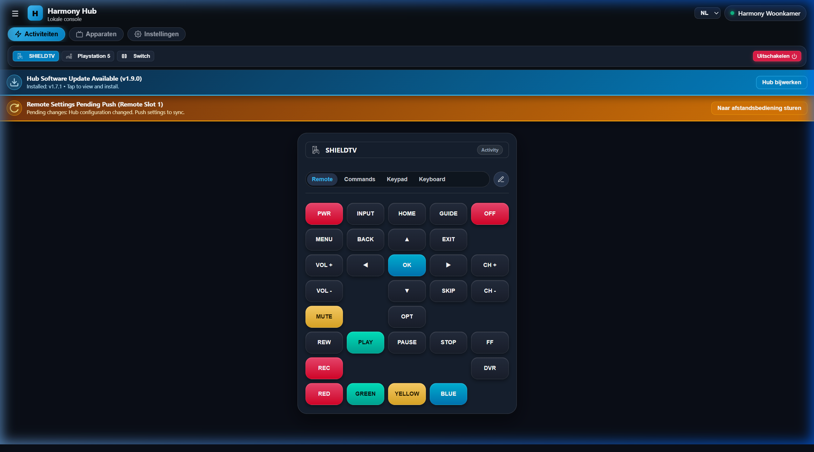
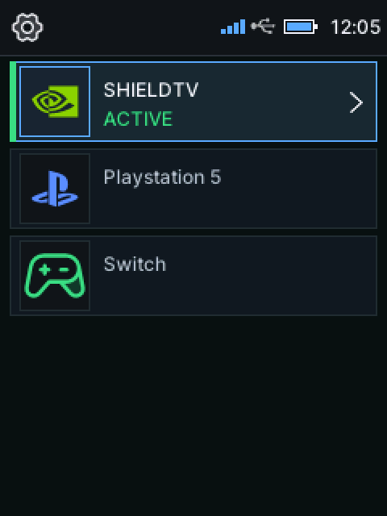
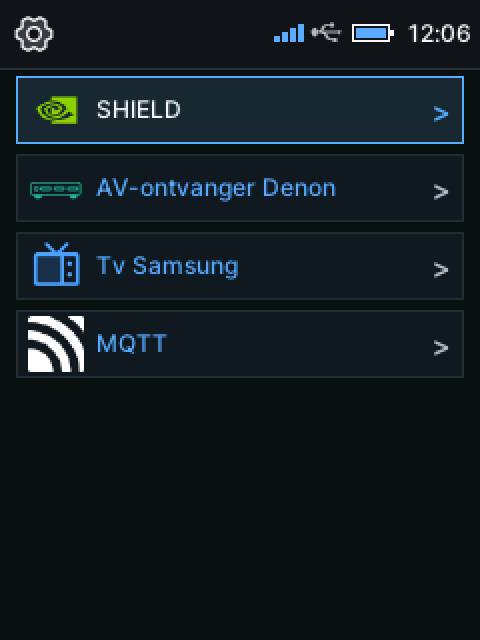
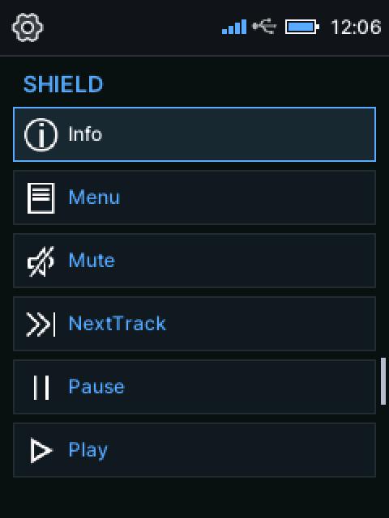
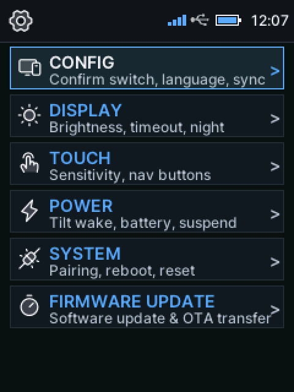

# HarmonyNG

Independent, open-source local control firmware and companion suite for the **Logitech Harmony Hub**, the **Harmony touchscreen remotes** (Elite, Ultimate, Ultimate One, Ultimate Home, 950, Touch), **Harmony Companion**, and **Harmony Smart Control** remotes. Restores full universal remote and smart home functionality with zero cloud dependency after Logitech's end-of-life (EOL).

<div align="center">
  <table>
    <tr>
      <td width="65%" align="center">
        <b>Harmony Hub Web UI & Companion App</b><br>
        <i>Autonomous local control console (REST & WebSockets)</i><br><br>
        
      </td>
      <td width="35%" align="center">
        <b>Harmony Touchscreen Remote</b><br>
        <i>Real-time native framebuffer UI (240x320 RGB565)</i><br><br>
        
      </td>
    </tr>
  </table>
</div>

---

## 🚀 Quick Start & Installation

Setting up HarmonyNG takes just a few minutes. Pre-built release bundles containing all binaries, modules, scripts, and deployment tools are ready on the [**Releases Page**](https://github.com/iranl/harmony-ng/releases) — **no compilation required**.

| Target | Installation Guide | Requirements |
| :--- | :--- | :--- |
| **Harmony Hub** | [**Harmony Hub Installation Guide**](docs/FIRST_INSTALL_HUB.md) | Harmony Hub (Standard `046D:C129` or Pro 2400 `046D:C132`), Micro-USB cable, PC (Windows, macOS, or Linux) with Python 3.13 or newer |
| **Harmony Touchscreen Remotes** | [**Harmony Remote Installation Guide**](docs/FIRST_INSTALL_REMOTE.md) | Harmony Elite, 950, Ultimate or Pro 2400 Remote (Skin 116), Micro-USB cable, PC with Python 3.13 or newer *(tested on a Harmony Ultimate, 2013; Ultimate Home, Touch and Pro 2400 supported, untested on physical hardware)* |
| **Harmony Companion & Smart Control** | [**RF Remotes Guide**](docs/REMOTE.md#harmony-companion--smart-control-screenless-remotes) | Harmony Companion or Smart Control remote; pairs directly over 2.4 GHz RF (no USB connection or rooting needed) |
| **Android Companion App** | [Download APK from Releases](https://github.com/iranl/harmony-ng/releases) | Android phone or tablet (Android 6 or newer); with authentication on, the app keeps an access token, never your password ([details](docs/FIRST_INSTALL_HUB.md#5-accessing-the-web-console--android-app)) |
| **Web UI** | Pre-installed on Hub at `http://<hub-ip>:8089` | Modern web browser |
| **Ethernet Setup** | [**Ethernet & Network Guide**](docs/ETHERNET_AND_NETWORK_SETUP.md) | Native onboard RJ45/PoE (Pro 2400) or OTG Micro-USB Ethernet Adapter (Standard Hub) |
| **Plugins & Marketplace** | [**Plugin Architecture & Guide**](docs/PLUGINS.md) | Community drivers (Roku ECP, PS5 Wake, Android TV) via 1-click marketplace |

> [!IMPORTANT]
> **Authentication is off after install**: every device on your network is admin on the Hub until you turn it on (web UI, **System** page, **User Accounts & Access Control**). See [API.md, section 11](docs/API.md#11-authentication--security-architecture).

---

## Architecture Overview

```
                      +-----------------------------------+
                      |   Client Application (SPA / App)  |
                      |  - Modern Vite + Vanilla JS + CSS |
                      |  - Android Capacitor Companion    |
                      +-----------------+-----------------+
                                        | HTTP REST & WebSockets
                                        v
+---------------------------------------+---------------------------------------+
|  Harmony Hub (Atheros AR9344 SoC - MIPS32 Linux)                              |
|                                                                               |
|  [hub_daemon] (Lean Native C Micro-Daemon)                                    |
|   ├── Non-blocking select() event loop (CPU < 2%, RAM < 8MB)                  |
|   ├── REST JSON API (/api/status, /api/inventory, /api/activities)            |
|   ├── WebSocket Server (/ws - live status & bidirectional button streaming)  |
|   ├── Activity Orchestrator (interlocks, start/stop step queues, delays)      |
|   └── IR Engine (ir_i2s.c / ir_encoder.c, through the stock I2S driver)       |
|  [hub_rf]      CC2544 RF daemon on /dev/rfspi (rf_main.c + rf_*.c, ACKs)      |
|  [hub_btstack] BTstack Bluetooth HID daemon (Apple TV, Shield, Fire TV)       |
+---------------------------------------+---------------------------------------+
                                        | 2.4GHz RF (CC2544 Mode 1 / Reports 0x12 & 0x20)
                     +------------------+------------------+
                     |                                     |
                     v                                     v
+---------------------------------------+ +---------------------------------------+
|  Harmony Touchscreen Remotes          | |  Harmony Companion & Smart Control    |
|   ├── Framebuffer UI (remote/*.c)     | |   ├── CR2032 coin cell, screenless    |
|   ├── Touch & physical controls       | |   ├── eQuad HID keyboard & consumer   |
|   └── Low-power CC2544 transceiver    | |   └── Direct Hub IR/BT/MQTT dispatch  |
+---------------------------------------+ +---------------------------------------+
```

---

## Subsystem & Feature Comparison (HarmonyNG vs. Stock Logitech Software)

The table below details every major functional component for both the **Harmony Hub** and the **Harmony touchscreen remotes**, comparing HarmonyNG with the original factory software stack:

### Harmony Hub

| Dimension | Stock Logitech Firmware | HarmonyNG Custom Firmware |
| :--- | :--- | :--- |
| **Cloud Dependency** | **100% Mandatory**: Requires Logitech AWS cloud servers for account authentication, provisioning, configuration sync, and unbricking. Bricked once servers go offline. | **0% Zero Cloud**: Fully autonomous local operation. No external servers, telemetry, or account sign-in required. Runs permanently offline. |
| **Core Architecture** | **Monolithic Lua Runtime**: `luaworks` and Lua 5.1/LuaJIT consuming 12–16 MB RAM and 15–30% CPU, guarded by an aggressive watchdog (`/usr/bin/watchdog`). | **Native C Micro-Daemon**: `hub_daemon` compiled for MIPS32 big-endian (static binary under 1 MB, < 2% CPU, < 8 MB RAM). Non-blocking `select()` event loop. |
| **Web & App Interface** | **Cloud-Mediated Mobile App**: iOS/Android app routes all initial discovery and setups through remote AWS endpoints. Local WebUI was completely removed in v4.x. | **Integrated Local WebUI & Android App**: Fast SPA served directly from the Hub flash (gzip-compressed), with companion Capacitor Android app and live WebSocket streaming. Optional login with user accounts (admin and user roles) and API tokens. |
| **Networking & Ethernet** | **Wi-Fi 2.4 GHz Only**: Restricted to 802.11b/g/n wireless. Micro-USB port locked to device gadget mode (USB serial / HID). No Ethernet support. | **Dual Network (Wi-Fi + Ethernet)**: Supports both **Harmony Hub Pro 2400** (native onboard Atheros GMAC `eth1` with PoE / RJ45 port; USB gadget mode remains fully active for PC control) and **Standard Harmony Hub** (dynamic USB Host mode activator switching on-chip Atheros EHCI controller to 480 Mbps host mode with Realtek RTL8152/8153, ASIX, SMSC, CDC-Ethernet dongles). Seamless link-state failover (Ethernet prioritized, Wi-Fi standby), unified static IP handover. See [Ethernet & Network Setup Guide](docs/ETHERNET_AND_NETWORK_SETUP.md). |
| **IR Transmission** | **HAL Subsystem**: Closed-source `hal` binary driving proprietary I2S kernel driver, restricted to fixed cloud database code sets. | **Own I2S IR Engine**: User-space IR engine (`ir_i2s.c`) that feeds the pulse stream to the stock `ath_i2s` kernel driver (`/dev/i2s`). Supports raw Pronto hex, Harmony raw timings, NEC family, Sony, RC5, RC5x, Sharp, Samsung, Toshiba, GoVideo, Roku, Saitek, Cambridge and Sky 28 Bit (RC6 mode 6) keycodes (`ir_encoder.c`; a keycode of another protocol, another RC6 mode for example, is refused and not sent: use Pronto or a learned code), across Port 1, Port 2, or front blaster. Learns codes through the Hub's IR receiver (one-shot capture and a capture mode). |
| **Bluetooth Engine** | **BlueZ 4 Stack**: Legacy BlueZ daemon with heavy D-Bus overhead, prone to random disconnections and pairing drops. | **BlueKitchen BTstack**: Linux HCI socket transport (the UART controller is attached with `hciattach ttyS0 bcsp` at boot), persistent pairing table, media keys, and an automatic reconnect script (`bt_reconnect.sh`, started per command or activity). |
| **RF Remote Engine** | **Proprietary eQuad Protocol**: Managed by `hal_hub` via `/dev/rfspi`. Locked to stock remote pairings and cloud IDs. | **Clean-Room CC2544 Driver**: Direct `/dev/rfspi` SPI Report `0x12` & `0x20` framing with ACK tracking, dynamic pairing, instantaneous bidirectional synchronization with touchscreen remotes, and native decoding for Harmony Companion & Smart Control screenless remotes with dual-slot activity mappings and MQTT event mirroring. |
| **Activity Orchestration** | **Rigid Cloud Sequences**: Static power macros compiled in the cloud. Out-of-sync devices require stepping through the mobile "Fix It" wizard. | **Stateful C Orchestrator**: `orchestrator.c` builds each switch from the leaving and the entering activity (devices that are in only one of them are powered off or on), runs one switch at a time with a step queue and delays, and sends live WebSocket and MQTT progress feeds. |
| **Smart Home & Automation** | **Cloud Skill & Deprecated XMPP**: Local XMPP blocked in firmware v4.15.206. Cloud skills face deprecation. | **Native Bidirectional MQTT**: Built-in MQTT client with Home Assistant MQTT Auto-Discovery (activity `select`, plus `sensor` and `button` entities; Home Assistant's MQTT integration has no `remote` platform). Full REST & WebSocket API. mDNS discovery (`_harmony-ng._tcp`), and an optional Logitech protocol layer (port 8088 with SSDP, off by default) for stock clients such as Home Assistant's core Harmony integration. |
| **Flash & Safe Recovery** | **Flash Wear & Brick Risk**: Unmonitored writes to JFFS2 flash. Bricked units require factory wipe. | **RAM-Isolated & Panic Protected**: All runtime logs/PIDs in tmpfs (`/tmp`). A boot counter starts the Hub in an emergency recovery mode (Wi-Fi and SSH only) after more than 5 boots in a row that did not stay up for 5 minutes. Downloaded OTA updates of Hub and remote are checked against a signed manifest (Ed25519) before they are installed. |
| **Extensibility & Plugins** | **Zero / Closed**: No plugin or custom driver support. Restricted to stock cloud code sets. | **Plugin System & Marketplace**: Supervised community micro-daemons with zero flash wear (sockets/logs in RAM tmpfs), non-blocking UNIX domain socket IPC, 1-click marketplace catalog, and custom repository support. See [Plugin Guide](docs/PLUGINS.md). |

### Harmony Touchscreen Remotes

| Dimension | Stock Logitech Firmware | HarmonyNG Custom Firmware |
| :--- | :--- | :--- |
| **GUI & Display Engine** | **Monolithic Lua GUI**: `luadraws` + `luaworks` taking 30+ seconds to boot, heavy memory footprint, closed stock assets. | **Native Framebuffer GUI**: `remote_ui.c` rendering directly to `/dev/fb0` (240x320 16-bit RGB565) in under 2 seconds. Anti-aliased bitmap fonts (built in, or per theme as `.faa` files converted from TTF on the build host) and selectable themes. |
| **Touch & Physical Controls** | **Vendor Input Handlers**: Custom event pipes dependent on stock daemons. | **Direct Linux Input Multiplexing**: Linux `/dev/input/event0` (physical buttons), `/dev/input/event1` (motion sensor) and `/dev/input/event2` (touch digitizer), with hold events sent while a key stays down. |
| **Hub Synchronization** | **Desktop USB Sync Required**: Updating button maps or activities required connecting the remote via USB to a PC running MyHarmony. | **Over-the-Air RF Sync**: Over-the-air synchronization over 2.4 GHz CC2544 RF using Report `0x20` protocol. Screen updates state immediately when an activity starts on WebUI or HA. |
| **Battery Life & Power Management** | **High Drain**: Accelerometer polled continuously at 50 Hz, unconfigurable button backlight draining battery in ~24–48 hours. | **Multi-Tier Power Optimization**: LIS3DH accelerometer on its stock motion interrupt (powered down when tilt wake is off), night-mode button backlight scheduler, and configurable screen timeouts. |
| **Offline Autonomy** | **Hub-Dependent Lockout**: Shows a persistent spinning gear / connection error screen if Hub is out of range or offline. | **Autonomous Cached Operation**: Operates smoothly offline from cached device profiles and button maps, with on-screen diagnostic settings and pairing tools. |

---

## Supported Remote Hardware

HarmonyNG supports all major Logitech Harmony physical remotes:

1. **Harmony touchscreen remotes: Elite 950, Pro 2400, Ultimate family (Handheld Remotes with Screen)**:
   - Full native framebuffer UI (`remote_ui.c`) at 240x320 RGB565.
   - Dynamic touch digitizer & physical button mapping.
   - Instant bidirectional RF state sync (time, activities, settings, device browser) over CC2544 Report `0x12`/`0x20`.
   - Two-tier hardware power management (Light and Deep standby with motion wake).
   - Remote settings backup to Hub and over-the-air (OTA) firmware updating.
   - *Harmony Ultimate, Ultimate Home and Harmony Touch share this architecture and are supported by the same binaries (tested on a Harmony Ultimate, 2013).*

   <div align="center">
     <table>
       <tr>
         <td align="center"><b>Activities</b><br><br></td>
         <td align="center"><b>Devices</b><br><br></td>
         <td align="center"><b>Commands</b><br><br></td>
         <td align="center"><b>Settings</b><br><br></td>
       </tr>
     </table>
   </div>

2. **Harmony Companion & Harmony Smart Control (Screenless Remotes)**:
   - **Native zero-rooting RF support**: Communicate directly with the Hub via CC2544 2.4 GHz eQuad protocol. No USB connection, rooting, or custom firmware installation required on the remote.
   - Simply put the remote in pairing mode to register it to one of the Hub's 6 remote slots.
   - Real-time decoding of eQuad HID Keyboard (Sub-ID `0x01`) and Consumer Control (Sub-ID `0x03`) frames directly in `hub_rf`.
   - Dispatches mapped IR commands, Bluetooth HID keys, activity switches, and MQTT button events instantly with zero lag.
   - Full per-activity physical button mapping in the Web UI with custom visual skins (including home automation buttons for Companion).
   - Independent per-slot configuration (`/data/harmony/remote_slot<N>_map.json`, N = 1 to 6), one-click mapping copy between slots, and slot-specific MQTT event topics.

3. **Physical Bluetooth BLE Remotes (e.g. Homatics B25)**:
   - Fully supported via the Hub Bluetooth stack with per-activity button mapping in the Web UI.
   - *Note: When a sleeping BLE remote is pressed, the first button press wakes the remote (showing a red light on the B25) and will drop; the second button press will register once the BLE remote finishes reconnecting to the Harmony Hub.*

---

## Known Differences (Compared to Stock Logitech Software)

While HarmonyNG restores complete local independence and dramatically reduces memory and CPU usage, note the following architectural difference from stock Logitech firmware:

1. **No Direct Local Network / IP Control (e.g. Roku ECP, Hue Direct, Sony IP)**:
   - **Community Plugins & Add-ons**: HarmonyNG includes a dedicated **Plugin Architecture & Community Marketplace** for direct local control of IP and Bluetooth devices without cloud mediation. Lightweight community micro-daemons (e.g. **Roku ECP**, **PlayStation 5 BT Wake**, **Android TV**) run directly on the Hub with zero flash wear. See [Plugin Architecture & Guide](docs/PLUGINS.md) and the [harmony-ng-plugins repository](https://github.com/iranl/harmony-ng-plugins).
   - **Home Assistant & MQTT Integration**: For thousands of other smart home devices (Hue, Sonos, custom lights), connect HarmonyNG to **Home Assistant via the built-in bidirectional MQTT bridge**.

---

## Repository Structure

```text
.
├── android-app/            # Legacy web UI (served by the Hub) & Android Capacitor project
├── frontend/               # New web UI (Vite), built by build/build_webui.py
├── build/                  # Cross-compilation toolchains, build, and deploy scripts
│   ├── patches/            # BTstack patches
│   ├── build_apk.py        # Android APK build and package script
│   ├── build_btstack.sh    # MIPS32 BTstack cross-compilation script
│   ├── build_webui.py      # Frontend Vite builder and gzip compressor
│   ├── compile_all.sh      # Master build script for the Hub and remote binaries
│   └── deploy_hub.py       # Hub deployment script (cross-platform Python)
├── docs/                   # Technical documentation
│   ├── API.md              # Complete REST & WebSocket API specification
│   ├── PLUGINS.md          # Plugin architecture, marketplace, and developer guide
│   ├── BLUETOOTH_HID_CODES.md # Bluetooth HID keycodes and mappings
│   ├── REMOTE.md            # Remote hardware, RF protocol, and display specs
│   ├── REMOTE_BATTERY_OPTIMIZATION.md # Power management & battery life guide
│   ├── FIRST_INSTALL_HUB.md   # First-time installation and rooting guide for Hub
│   ├── FIRST_INSTALL_REMOTE.md # First-time installation and setup guide for the remote
│   ├── HARMONY_RF_PROTOCOL.md # Reverse-engineered CC2544 2.4GHz RF protocol
│   ├── HOME_ASSISTANT.md   # Home Assistant: API, MQTT, MQTT discovery, Logitech protocol
│   ├── ETHERNET_AND_NETWORK_SETUP.md # Hub Ethernet and network configuration guide
│   ├── RNDIS_AND_NETWORK_SETUP.md # USB network (RNDIS) driver and setup guide
│   ├── openapi.yaml        # OpenAPI 3.1 description of the HTTP API
│   ├── index.html          # Swagger UI page for openapi.yaml (GitHub Pages)
│   ├── OFFLINE_UNBRICK_AND_ROOT_GUIDE.md  # Recovery, UART, and SPI flash guide
│   └── TRANSLATIONS.md     # Web UI languages: keys, checks, machine translations to check
├── drivers/windows/rndis/  # Windows RNDIS driver package for the remote's USB network
├── remote/                  # Remote userspace binaries and deployment tools
│   ├── bootstrap_serial.py # Hardware serial bootstrap
│   ├── deploy_remote.py     # Remote deployment script (cross-platform Python)
│   ├── setup_remote.py     # Multi-step remote provisioning tool
│   └── rcS.local           # Remote boot script (starts USB Ethernet and SSH)
├── scripts/                # Version bump, release notes, OTA publishing, CA bundle update
├── tests/                  # Host test suite (tests/run_mock_suite.sh)
├── payload/
│   ├── bin/                # Target MIPS executables for Hub
│   ├── modules/            # USB Ethernet kernel drivers (r8152, asix, cdc_ether, etc.)
│   ├── scripts/            # Hub startup (init.sh), network manager
│   └── source/             # Clean-room native C source code
│       ├── hub_daemon.c  # Hub micro-daemon and master select() loop
│       ├── config_store.c  # Atomic JSON device/activity configuration store
│       ├── http_server.c   # Lightweight REST JSON API server
│       ├── ws_server.c     # RFC 6455 WebSocket server
│       ├── state_watch.c   # Pushes Bluetooth, remote and config changes to the web UIs
│       ├── ir_i2s.c        # IR transmitter and receiver on the stock I2S driver (/dev/i2s)
│       ├── ir_encoder.c    # Protocol bit encoders (NEC family, Sony, RC5, Sharp, Samsung, Toshiba, ...)
│       ├── rf_main.c       # hub_rf: CC2544 RF protocol engine (with rf_*.c)
│       ├── hub_btstack/    # BTstack Bluetooth HID daemon integration
│       ├── remote/         # Remote framebuffer GUI & input application (remote_ui)
│       └── hub_util.c      # Multicall utility (sync, mknod, ehci, eth_fix, sntp, ota-verify, usbwifi)
└── tools/
    ├── backup_hub.py       # Golden and rolling tar backups of the Hub's configuration over SSH
    ├── factory_reset.py    # Revert to stock: runs the device's factory_reset.sh (deletes settings and keys)
    ├── harmony_firmware.py # SUS firmware check, download, flasher & icon extractor
    ├── harmony_hid.py      # USB HID client for the Hub and the touchscreen remotes (no dependencies)
    ├── migrate_hub_configs.py # Stock, v1.x and backup-bundle configurations to today's devices/activities
    ├── ota_sign.c          # Ed25519 key and signature tool for the OTA manifest (release workflow)
    ├── remote_render/      # Draws the remote's screens on a computer with the firmware's code (PNG)
    ├── restore_stock.py    # All-in-one stock restore and configuration recovery tool
    ├── rf_debug/           # rf_query and rf_sniff: CC2544 radio debug tools for the Hub
    ├── root_hub_usb.py     # USB HID root unlock tool with auto stock backup (.tar)
    ├── set_wifi_usb.py     # Read or set the Hub's Wi-Fi over USB when it is on no network
    ├── setup_remote_driver.ps1 # Windows: RNDIS driver and 192.168.2.2 for the remote's USB network
    ├── ssh_hostkeys.py     # SSH host key policy shared by the host tools (--reset-host-key)
    ├── unbrick_recovery/   # Tools to get Dropbear back onto a Hub without SSH (file receiver + sender)
    └── usb_state.py        # USB device state, Windows driver and IP checks for the host tools
```

---

## Building from Source

Build requires Linux (or WSL2) with standard build utilities and two Bootlin toolchains,
extracted into `build/toolchains/` (the build scripts pick the first `*--uclibc--stable*`
folder they find there). CI and the release use exactly these files and check them:

| Toolchain | URL | SHA-256 |
|---|---|---|
| Hub, MIPS32 big-endian | `https://toolchains.bootlin.com/downloads/releases/toolchains/mips32/tarballs/mips32--uclibc--stable-2017.05-toolchains-1-1.tar.bz2` | `a75aeb0f82eaeaf1989a7dfdf80219486b5ed1470c29c6f253fbcf824922c29f` |
| Remote, ARMv5 EABI | `https://toolchains.bootlin.com/downloads/releases/toolchains/armv5-eabi/tarballs/armv5-eabi--uclibc--stable-2017.05-toolchains-1-1.tar.bz2` | `9afe6d92b2fdb5eee75c90f776374d19aa1203d5679651b289a4030dc9982036` |

Both are Buildroot 2017.05 with gcc 5.4.0 and uClibc-ng 1.0.24, and every device binary is
linked statically, so that C library is inside each binary. Later uClibc-ng releases fixed
resolver flaws listed in public advisories for 1.0.24 (among them CVE-2021-43523 and
CVE-2022-30295); the Hub resolves the MQTT broker and NTP server names with it. A newer
toolchain has to keep kernel headers old enough for the Hub (2.6.31) and the remote (2.6.37).
The binaries kept in the repository (SSH servers, kernel modules) are listed in
`tools/bin/README.md`.

```bash
# 1. Compile Hub native binaries (MIPS32 big-endian): hub_util, hub_daemon, hub_rf and hub_btstack.
#    For hub_btstack it runs build/build_btstack.sh, which fetches the pinned BTstack commit
#    with git (network needed). "./build/compile_all.sh hub" builds the first three only.
./build/compile_all.sh all

# 2. Compile the remote binaries (ARM): remote_ui, remote_sync, the themes and remote_ui.ota.gz
./build/compile_all.sh remote

# 3. Build the Web UI into payload/www, gzipped as the Hub serves it
#    (legacy = android-app/, the default; new = frontend/; run "npm install" in that folder first)
python3 build/build_webui.py --ui legacy
```

The host tools (`build/deploy_hub.py`, `remote/setup_remote.py`, `remote/deploy_remote.py` and
the Python tools in `tools/`) need Python 3.13 or newer and stop with a message on an older one.

`python build/deploy_hub.py <HUB_IP>` copies the built binaries and scripts to a Hub over SSH
and builds and copies the web UI. Options:
`--ui legacy|new` (default `legacy`), `--webui-only`, `--reboot` (default is a hot restart),
`--dry-run` / `-n` (reports what would change), `--no-backup`, `--stage-remote-ota`,
`--dev-btstack` (installs `build/output/hub_btstack_dev`, the Bluetooth daemon with BTstack info logs;
from a git checkout only), `--key <private key>` and `--user`.

### Running the tests

```bash
python -m pip install pyyaml aioharmony==1.0.8
./tests/run_mock_suite.sh     # firmware tests
./tests/run_host_tools.sh     # host tools tests
```

CI runs both on Python 3.13. The firmware tests run on every change, split in four groups on
separate machines at the same time (`SUITE_GROUP=1` to `4` runs one group locally): they need
`gcc`, build `hub_daemon` and the other firmware code for the PC and run it against mock
hardware. The host tools tests (install, deploy, backup, recovery, migration and build tools)
run when a `.py` file or `build/`, `remote/`, `scripts/` or `tools/` changes. Neither needs a
Hub or a remote.

The web UIs come in six languages; see [`docs/TRANSLATIONS.md`](docs/TRANSLATIONS.md) for how texts
are translated and how to check them.

---

## Extracting Official Remote UI Icons

The official Logitech Elite remote firmware contains about 1,350 official UI icons (activity icons, command glyphs, power toggles, device branding). You can extract all stock icons directly from the official firmware bundle (`.hfw2` SquashFS filesystem) without needing a remote connected over USB or transferring files over SSH.

### Automated Extraction During Hub Deployment
When running `python build/deploy_hub.py <HUB_IP>`, the installer checks for `build/icons.tar.gz`. If missing, it automatically prompts to download official Elite firmware (`remote_111_4.15.330.hfw2`), extract the icons, package them into `build/icons.tar.gz`, and stage them to `/cache/icons.tar.gz` on the Hub.

### Standalone Extraction Using Python
You can also extract icons or build the WebUI archive manually at any time on any platform (Windows, macOS, Linux). 7-Zip must be installed (`7z` or `7zz` on the PATH: 7-Zip on Windows, p7zip on Linux, `brew install sevenzip` on macOS); the tool stops with an error without it:

```bash
# Extract all official icons and build the Hub WebUI archive:
python tools/harmony_firmware.py extract-icons --archive build/icons.tar.gz

# Or extract raw PNG icons into a directory of your choice (default: data/remote_icons/extracted).
# The PNGs land in <out-dir>/icons/, the stock tree in <out-dir>/opt/luadraws/appscommon/asset/.
# Do not use payload/www: the web UI build empties that folder.
python tools/harmony_firmware.py extract-icons --out-dir data/remote_icons/extracted

# Use a firmware bundle you already have instead of downloading one:
python tools/harmony_firmware.py extract-icons --firmware path/to/remote.hfw2 --archive build/icons.tar.gz
```

Without `--firmware` the tool uses the newest remote `.hfw2` bundle in `firmware/` and downloads one only when there is none. `--android` also copies the PNGs into `android-app/public/assets/icons/`.

### How It Works
1. Downloads official Elite firmware bundle (`remote_111_4.15.330.hfw2`) from Logitech update servers (or uses cached copy).
2. Unpacks the internal SquashFS root filesystem with 7-Zip.
3. Indexes and extracts the PNG assets (about 1,350) across `footer`, `hopsactivity`, `juniperactivity`, `commands`, `devices`, and `settings`.
4. Packages them into `build/icons.tar.gz`. `deploy_hub.py` repacks this archive (`tools/icon_pack.py`) before it installs it as `/cache/icons.tar.gz`. The result is still a plain `tar.gz`, but the Hub can now read one icon at a time from flash instead of unpacking about 6 MB of icons into RAM (`/tmp`). An archive installed by an older deploy or by an OTA update has no pack index. The web daemon still unpacks such an archive into `/tmp/www/assets/icons` until the next `deploy_hub.py` run.

---

## Backup & Restoration Safety (No Gzip)

All Hub partition backups and stock configuration restores (`tools/root_hub_usb.py`, `tools/restore_stock.py`, `tools/backup_hub.py`) use **plain uncompressed tar archives** (`.tar`, not `.tar.gz`).

- **Why no gzip?** Embedded MIPS BusyBox has limited RAM and flash bandwidth. Streaming uncompressed tar avoids CPU exhaustion, reduces write cycles, and prevents out-of-memory kernel panics during recovery.
- **Stock Backup Location**: `backups/stock_hub_backup_<timestamp>.tar` (and `backups/stock_hub_backup_latest.tar`).
- **Restoration**: `python tools/restore_stock.py` restores `/cache` and `/data` cleanly and reboots into configured stock firmware.


---

## API Documentation & OpenAPI Specification

HarmonyNG exposes an extensive local REST and WebSocket API running on port `8089`.

- **Interactive Swagger UI (GitHub Pages)**: [https://iranl.github.io/harmony-ng/](https://iranl.github.io/harmony-ng/)
  - Features real-time **"Try it out"** testing against your local Harmony Hub (e.g. `http://<hub-ip>:8089` or `http://harmony-ng-<hub_id>.local:8089`).
- **OpenAPI 3.1 Spec**: [`docs/openapi.yaml`](docs/openapi.yaml)
- **HTTP & WebSocket API Specification**: [`docs/API.md`](docs/API.md)
- **Home Assistant, four ways (API, MQTT, MQTT discovery, Logitech protocol)**: [`docs/HOME_ASSISTANT.md`](docs/HOME_ASSISTANT.md)

---

## License & Legal Information

This project is licensed under the **MIT License**. See [`LICENSE`](LICENSE) for complete terms.

### Attribution & Acknowledgments
This project was originally inspired by and based on the foundational research and repository created by [Ripthulhu](https://github.com/Ripthulhu) (`harmony-hub-control` and `harmony-hub-root`). We express our sincere gratitude and credit to **Ripthulhu** for the original idea, pioneering hardware investigations, and proof-of-concept groundwork before this complete architectural reimplementation and expanded feature suite was undertaken.

### Third-Party Components
- **BlueKitchen BTstack**: Dual-licensed; free for non-commercial open-source use.
- **cJSON**: MIT License (Dave Gamble and contributors).
- **stb libraries**: MIT / Public Domain (Sean Barrett).
- **Dropbear**: MIT/X11-style license (Matt Johnston).

### Trademark Disclaimer
Logitech, Harmony, and associated trademarks are the property of Logitech Europe S.A.
This project is an independent community development effort to keep working hardware out of landfills and is not affiliated with, endorsed by, or sponsored by Logitech.