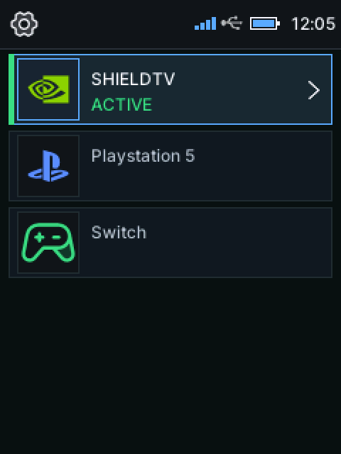
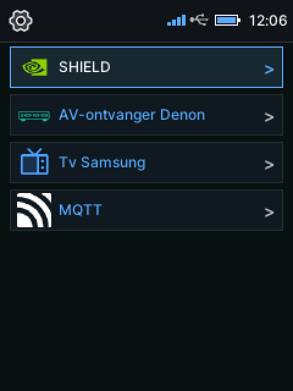
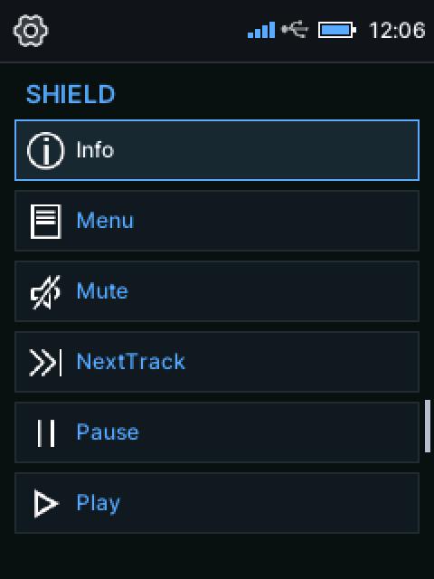
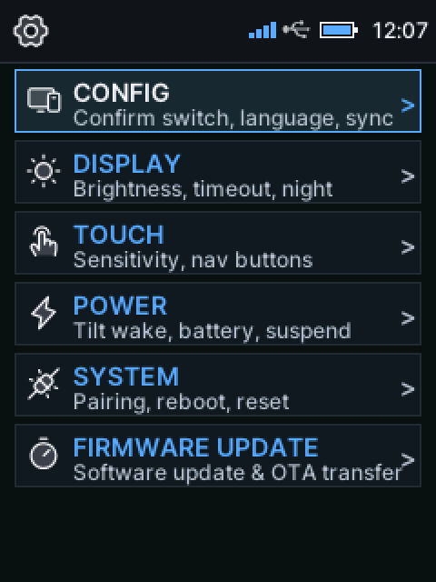

# Logitech Harmony Remote Hacking & Support

> [!NOTE]
> **Hardware Family Compatibility**:
> The **Harmony Pro 2400 Remote** (Skin 116), Harmony Ultimate (Home), and Harmony Touch share the same underlying architecture (TI DaVinci ARM, CC2544 RF, ClearPad touch, 240x320 RGB565 LCD). Pro 2400 remote runs Dropbear SSH out of the box in stock firmware 10.0.215. All are supported using the same tooling and `remote_ui` binary (*untested on physical Pro 2400 remote hardware*). Tested on a Harmony Ultimate (2013, skin 100, firmware 4.15.330); its differences are listed in [FIRST_INSTALL_REMOTE.md](FIRST_INSTALL_REMOTE.md#harmony-ultimate-2013).

<div align="center">
  <table>
    <tr>
      <td align="center"><b>Activities</b><br><br></td>
      <td align="center"><b>Devices</b><br><br></td>
      <td align="center"><b>Commands</b><br><br></td>
      <td align="center"><b>Settings</b><br><br></td>
    </tr>
  </table>
</div>

The screenshots come from the remote's framebuffer: with the remote on USB, run `python tools/capture_remote_fb.py -o shot.png` (`--scale 1` for 240x320, `--page` to pick a buffer page).

## Serial Console & U-Boot (UART)
Baud rate: `115200 8N1` on serial pad.

To prevent kernel console suspend when remote idles:
```
printenv bootargs
setenv bootargs ${bootargs} no_console_suspend
saveenv
boot
```

### Serial Bootstrap (`remote/bootstrap_serial.py`)
To push Dropbear, generate SSH keys, enable USB Ethernet, and install the boot script directly over serial (`--baud` sets the speed, default 115200):
```sh
pip install pyserial
python remote/bootstrap_serial.py --port COM3 --ssh-pubkey ~/.ssh/harmony_owner_ed25519.pub
```
This utility:
1. Starts `/usr/bin/usbeth start` on the remote.
2. Streams base64-encoded static binaries (the Dropbear multi-call binary, which serves as `dropbear`, `dropbearkey` and `scp`, and `remote_sync`) to `/data/`.
3. Generates Dropbear host keys in `/etc/dropbear/`.
4. Installs your SSH public key into `/home/root/.ssh/authorized_keys`. Without `--ssh-pubkey` it takes the owner key `setup_remote.py` uses (the newest `~/.ssh/harmony_owner_*.pub`, created when there is none): the stock root password is not known, so without a key nobody could log in.
5. Installs the boot script `/etc/init.d/rcS.local` (`remote/rcS.local`).
6. Starts Dropbear daemon (`/data/dropbear -R`, key logins only).

How the files get there: the stock firmware has no `base64` or `uudecode`, so the tool decodes the small native decoder (`b64dec_tiny`) with the stock Lua and then each file with it, sends the base64 text in short lines, and checks every file with `md5sum` before it gets its final name. A file that does not arrive intact stops the tool, and the boot script already on the remote is left as it is. The Dropbear multi-call binary goes to `/data/dropbearmulti` (`/data/dropbear`, `/data/dropbearkey` and `/data/scp` link to it), the key also to `/etc/dropbear/authorized_keys` and `/root/.ssh/authorized_keys`, and Dropbear is started for key logins only (without `-B`).

---

## USB Ethernet & Dropbear SSH Setup
Architecture: ARMv5TE little-endian (`armv5tejl`, uClibc-0.9.30.1).

### Host Connection (PC)
- **USB Ethernet Interface**: `192.168.2.2 / 24`
- **Remote IP**: `192.168.2.1`
- **SSH Access**:
  ```sh
  ssh -i ~/.ssh/harmony_owner_ed25519 root@192.168.2.1
  ```
- **SCP File Transfer** (requires legacy `-O` flag):
  ```sh
  scp -O -i ~/.ssh/harmony_owner_ed25519 file.bin root@192.168.2.1:/data/
  ```
  With the `harmony-remote` entry for `~/.ssh/config` that `setup_remote.py` prints (and writes when it is run with `--ssh-config`), `scp -O file.bin harmony-remote:/data/` works too.

---

## SSH Deployment Script (`remote/deploy_remote.py`)
Once SSH is operational, deploy updated custom firmware (`remote_ui`), tools, and boot scripts:
```sh
# Cross-platform (Linux/macOS/Windows)
python remote/deploy_remote.py --ip 192.168.2.1 --key ~/.ssh/harmony_owner_ed25519
```
Before it changes anything on the remote, `deploy_remote.py` runs a ready-to-go check and stops, with what to do, if any of these fails:
- `remote/bin/remote_ui` and `remote/bin/remote_sync` are built.
- The remote is an ARM touchscreen remote with the commands the deployment runs, including `scp`.
- A BusyBox with `tar` can unpack the themes. Stock BusyBox 1.13.4 has no `tar`, so `/data/busybox` must already have one, or `remote/bin/busybox` (from `./build/build_busybox.sh arm`) must be there to install first. The check runs a new `remote/bin/busybox` from `/tmp`.
- `/data` has room for the changed files and the themes, each written beside its old copy.

`--check` runs only the check. The deployment installs `busybox` before any other file and unpacks the themes with `/data/busybox tar`.

This script uploads, to `/data/`:
- `busybox` (first, for the themes), `remote_ui` (custom framebuffer UI & CC2544 RF engine), `remote_sync` (ARM sync helper, symlinked to `/data/sync` and `/usr/bin/sync`), `dropbear`, `dropbearkey`, `scp`
- the scripts `init.sh`, `remote_watchdog.sh`, `safe_reboot.sh`, `factory_reset.sh`
- the themes, and the boot script `remote/rcS.local` as `/etc/init.d/rcS.local`

A file is uploaded only when its MD5 differs from the copy on the remote (the themes are always unpacked again). `remote_ui` keeps running during the upload; at the end the tool stops and starts the runtime (`/data/init.sh stop`, then `start`). It reboots the remote instead with `--reboot`, or when another process still holds the hardware watchdog. If a file fails to upload, nothing is restarted.

Other options:
- `--user`: SSH user (default `root`). Without `--key` the tool takes `$SSH_KEY`, else the newest `~/.ssh/harmony_owner_*` key.
- `--no-sync`: do not create `/data/force_sync`. Without it, `remote_ui` asks the Hub for a full config push at its next start.
- `--no-screen`: writes `no_screen=1` to `/data/remote_settings.conf` (a remote with a broken screen).
- `--factory-reset`: returns the remote to the stock firmware after you type `RESET`; nothing is deployed.

---

## Files Named `elite_*` (Older Builds)
Builds before the elite -> remote rename used `elite_*` names. Nothing has to be done by hand:

- On the remote, `remote_ui` renames them at start (`init.sh start` and `init.sh migrate` do the same): `/data/elite_ui`, `elite_sync`, `elite_watchdog.sh`, `elite_settings.conf`, `elite_ui.conf`, `elite_rf_config.json`, `elite_activity_usage.conf`, `elite_ui.bak` and `elite_conf_p/` become `remote_*`. A settings or data file that already exists under the new name is kept; a regular file `/data/elite_ui` or `/data/elite_sync` (put there by an older installer) replaces the new binary. The old file names stay as symlinks to the new ones, so an older supervisor or a rollback still finds them.
- An RF update from a remote on an older build works: the package also carries the binary as `elite_ui`, the name older installers look for.
- `deploy_remote.py` renames the files before it uploads.
- On the Hub, `hub_rf` renames `elite_slot<N>_version.json`, `elite_slot<N>_config.json` and `elite_ui.version`, and deletes an update image left on flash under either name (`elite_ui.ota.gz`, `remote_ui.ota.gz` in `/data/harmony` and `/cache`): images are staged in `/tmp` only. The per-remote MQTT keys (`eliteRemoteTopic` / `eliteRemoteEvents`, and `remoteTopic` / `remoteEvents`) are ignored and removed at the next MQTT save: button events always go to `<base>/remote/<slot>/button` (API.md 8.1). Button events of an RF remote carry the source `remote_rf`; the Hub no longer sends or checks the older `elite_rf`.
- The tools still accept `--target elite` and `compile_all.sh elite` as aliases of `remote`.

---

## Recovery When `remote_ui` Does Not Start or Keeps Restarting
The remote has no automatic safe mode. Its boot script (`remote/rcS.local`, installed as
`/etc/init.d/rcS.local`) deletes `/data/reboot_counter` at every boot and always starts the runtime
(`/data/init.sh start`). A reboot counter with an emergency mode exists on the Hub only. The ways
back from a build that crashes or hangs:
- **USB**: when the remote boots on USB power (or the power source cannot be read), the boot script
  starts USB Ethernet and Dropbear SSH before the runtime, so `ssh root@192.168.2.1` works even
  while `remote_ui` crashes. Deploy a working build with `deploy_remote.py`.
- **Serial console**: `remote/bootstrap_serial.py` (above) installs SSH and the boot script over the
  serial pad.
- **Hardware factory reset**: hold `Menu` and `Off` for about 20 s (FIRST_INSTALL_REMOTE.md,
  section 7). It removes the HarmonyNG files and returns the remote to stock; root it again with
  `setup_remote.py`.

What the runtime does by itself: the supervisor in `/data/init.sh` starts `remote_ui` again when it
ends. When `/data/remote_ui` is missing, or failed 3 times in a row within a minute of its start,
the supervisor starts the previous version instead, which an RF update keeps as
`/data/remote_ui.bak`. After a failed start it waits 1 s (the first three times), then 5 s, 30 s
and from then on 300 s before the next one.

---

## Runtime Reference (`remote_ui`, Supervisor, Files)
- **Supervisor**: `/data/init.sh start | stop | restart | status | migrate`. `start` (run by the boot
  script) renames files of older builds, makes the stock UI binaries non-executable, sets the kernel
  to reboot 3 s after a panic, an oops or a task hung for 30 s, starts USB Ethernet and Dropbear on
  USB power, and runs `remote_ui` in a loop until `/tmp/remote_stop` exists (`stop` creates it).
- **`remote_ui` options**: `--no-touch`, `--no-gyro`, `--no-cap` (capacitive keys off), `--blank`
  (start with the screen off), `--pair` (start pairing), `--no-screen`. The supervisor passes none.
- **Signals**: `SIGUSR1` wakes the screen, `SIGUSR2` blanks it and suspends at once (on battery).
- **Trigger files** (checked in every round of the main loop, then deleted): `/tmp/trigger_wake`
  wakes the screen, `/tmp/trigger_rf_pair` starts pairing, `/tmp/trigger_rf_unpair` unpairs.
  `/data/force_sync` makes the next start of `remote_ui` ask the Hub for a full config push.
- **Hardware watchdog**: `remote_ui` opens `/dev/watchdog` and writes to it every 5 s, from the
  main loop and the power thread. The driver resets the remote after 10 s without a write and cannot
  be stopped once armed, so `remote_ui` must not stay stopped for longer (the deploy tool stops and
  starts it in one command). It closes the device before a suspend and opens it again after.
- **Logs**: `/tmp/remote_ui.log` (output of `remote_ui`, moved to `/tmp/remote_ui.log.1` at 512 KB),
  `/tmp/remote-init.log` (supervisor), `/tmp/power_debug.log` (with Debug Logging on),
  `/data/crash.log` (written by the crash handler). When `remote_ui` ends with an error the
  supervisor adds a line to `/tmp/harmony_crash.log` and saves the kernel log as
  `/tmp/last_kmsg.log`; with Debug Logging on both go to `/data` instead. Everything in `/tmp` is
  lost at a reboot (see the flight recorder below).
- **Files in `/data`**: `remote_settings.conf` (the settings, one `key=value` per line: `touch`,
  `physical_nav`, `cap_buttons`, `touch_sens`, `gyro`, `deep_standby` (`-1` at once,
  `0` never, or 15, 30, 60, 120, 240 minutes), `btn_backlight`, `night_start`, `night_end`,
  `timeout`, `brightness`, `no_screen`, `log_level`, `debug_logging`, `confirm_act`, `slot`,
  `language`, `theme`, `layout` (`theme`, `list`, `grid`, `carousel`), `order` (`yours`, `used`),
  `tz`), `remote_rf_config.json` (the config the Hub pushed), `remote_activity_usage.conf` (for
  the Most Used order), `debug_logging.conf` (exists while Debug Logging is on), `themes/<name>/`
  and `assets/custom/` (icons the Hub sent).
- **Update package** (`remote_ui.ota.gz`, built by `build/compile_all.sh remote`): a gzipped tar
  with `remote_ui` (also as `elite_ui` for installers of older builds), `remote_sync`, `rcS.local`,
  `init.sh`, `remote_watchdog.sh`, `factory_reset.sh`, `safe_reboot.sh` and `themes/`. After an RF
  transfer the remote checks the SHA-256 digest, unpacks to `/tmp/remote_ota_pkg`, checks that
  `remote_ui` is an ELF file, writes every file as `<target>.new` next to its target, replaces
  the packaged themes, then renames each file into place and keeps the previous one as
  `<target>.bak`. It then reboots on the cradle or USB, and restarts `remote_ui` in place on
  battery.

---

## Flight Recorder (a Log That Survives a Battery Pull)
`/tmp/remote_ui.log` and the power debug log live in RAM: they are gone after a reboot, a watchdog reset or a
battery pull, which is exactly when a remote that stopped responding needs them. The flight recorder is a small
event log on flash for that case.

- **Turn it on**: `touch /data/flightlog_on` over SSH. **Turn it off**: `rm /data/flightlog_on`. No restart needed.
- **Read it**: `cat /data/remote_flightlog.txt` (the previous file, after 1 MB, is `/data/remote_flightlog.txt.1`).
- Every record is one line, written and `fsync()`ed before `remote_ui` continues, and ends with the state at that
  moment: battery voltage, percentage and power source, screen, running activity, a switch, sync or update in
  progress, RF link and the age of the last Hub frame.
- It costs one small flash write per record (a few hundred a day in normal use), so it is a diagnostic: turn it
  off when you have what you need.

| Record | Written |
|---|---|
| `BOOT` | At every start of `remote_ui`: version, system uptime, and the last record of the previous run |
| `CONFIG` | After `BOOT`: sleep state, deep standby setting, screen timeout |
| `SCREEN_OFF` / `SCREEN_ON` | The display blanks or wakes (`off_s` = how long it was off) |
| `SUSPEND_ENTER` | Right before the kernel is asked to sleep |
| `SUSPEND_RETURN` | After the resume: `slept_ms`, `awake_ms` (time spent going in and coming out), `wakeup_event` (`key`, `alarm`, `touch`, `lowbatt`, `none`), or the error |
| `KLOG` | After every resume: the newest lines the kernel printed since the last one (the board's pin dump is left out) |
| `POWER` | The power source changed (battery, usb, cradle) |
| `HEARTBEAT` | Every 5 minutes awake, and after a resume |
| `EXIT` / `CRASH` | A clean stop, or a crash signal |

**Reading a halt.** When the remote stopped responding and only pulling the battery brought it back, look at the
`BOOT` record of the next start. `prev=SUSPEND_ENTER ... SUSPEND_DID_NOT_RETURN` means it went into that suspend
and never came out; `prev_t` is when. Any other `prev=` is the last thing it did before it stopped, and the
`HEARTBEAT` records show until when it was still running.

`KLOG` reads the kernel log with "read and clear", so while the recorder is on `dmesg` only shows what was printed
since the last resume.

---

## Note on Busybox `sync`
BusyBox v1.13.4 on both the Hub and the remote lacks the `sync` applet. Never run raw `sync` in scripts. Always use:
```sh
sync 2>/dev/null || /data/remote_sync 2>/dev/null || /data/sync 2>/dev/null || true
```

---

## Frame Timing

`remote_ui` can log how long each screen update takes, to check screens against the 27.8 ms animation frame budget. Over SSH:

```sh
touch /tmp/remote_frame_timing     # start logging, within a second
tail -f /tmp/frame_timing.log
rm /tmp/remote_frame_timing        # stop
```

Each line is `ms screen theme layout render_us present_us flipped decodes scales`:
- `ms`: monotonic time;
- `screen`: what the frame shows (`activities`, `activity`, `devices`, `settings/N`, `menu`, `help`, …);
- `theme`, `layout`: the theme's name and the home layout (`list`, `grid` or `carousel`);
- `render_us`: time to draw the frame;
- `present_us`: time to show it;
- `flipped`: `1` when the frame was shown by page flipping, `0` when it was copied into every framebuffer page;
- `decodes`, `scales`: PNG images decoded, and scaled to a new size, while drawing the frame. Both are 0 once a screen's images are cached.

A screen change that slides or crossfades (`transition` lines) logs each frame of the transition with the time to composite it as `render_us`. The frame that started it logs the whole transition as its `present_us`.

The log is in `/tmp`, so it is lost at reboot.

---

## Sleep Behavior & Expected Run Times

The Harmony Elite remote features a **1,300 mAh (3.7V Li-ion, ~4.81 Wh)** battery. In custom firmware (`remote_ui`), sleep is managed via a two-tier hardware power state architecture: **Light Standby** and **Deep Standby**.

### Standby Power States & Wake Triggers

| Standby Tier | Timeout Range | Hardware State | Wake Triggers |
| :--- | :--- | :--- | :--- |
| **Active** | While interacting | Screen ON (PWM 1-5), CPU @ 456 MHz, Clearpad touch active, LIS3DH at the stock 25 Hz with a motion interrupt (no polling) | N/A |
| **Light Standby** | From the blank until deep standby is due (2 s with the default "at once"; for ever with "never" or while the remote is powered) | Screen OFF (`FB_BLANK_POWERDOWN`), Backlight 0, ClearPad touch in its own doze between touches, CPU in WFI, LIS3DH INT1 IRQ active (0 I2C reads) | • **Pickup / Motion** (LIS3DH INT1 hardware IRQ)<br>• **Any Physical Button**<br>• **Touch and the capacitive keys** (when enabled)<br>• **The Hub over RF** (wake request) |
| **Deep Standby** | When the Deep standby setting is due (default: 2 s after the blank), on battery only | Kernel suspend to RAM: processor stopped, the MSP430 keeps the keys and the alarm | • **Any Physical Button** (Power, Activities, Devices, OK, Vol, D-pad, etc.)<br>• **The cradle**<br>• **The hourly MSP430 alarm** (reports, then sleeps again) |

Deep standby is the kernel's suspend to RAM, on battery only. The **Deep standby** setting picks
when it starts after the screen blanks: **at once** (the default since 2026-11, as the stock
firmware does: 2 s after the blank, the time for a key release and its acknowledgement), 15, 30,
60, 120 or 240 minutes, or never. In suspend only a physical button, the cradle and the hourly
MSP430 alarm wake the remote; RF wake requests from the Hub do not reach it. After an alarm wake
the remote stays up until it has linked and reported its battery (at most 8 s), then suspends
again, so a sleeping remote reports once an hour. **Powered (cradle, USB or charging) it never
suspends**: the Hub can wake it, push config and update it over RF at any time.

**A held key keeps the remote awake.** While a hard key or a capacitive key is down (the kernel's
key state, `EVIOCGKEY`), the screen does not blank at the idle timeout and no suspend starts, also
not from a Hub sleep request or `SIGUSR2`; the timeout counts from the release. A key down for more
than 5 minutes no longer counts, so a key pressed in a sofa cushion does not empty the battery.

`CLOCK_MONOTONIC` stops during suspend and the remote's kernel (2.6.37) has no `CLOCK_BOOTTIME`,
so `remote_ui` measures each suspend on the wall clock (restored from the MSP430 RTC on resume)
and adds it in `get_boot_ms()`. The battery's timing (rested reading, slow drop, reports) and the
time since the screen blanked use that clock. After a resume the battery samples start fresh,
the first reading counts as rested when the suspend lasted 30 s or more (the cell rested all that
time), and a battery report is requested, for an alarm wake and a button wake alike.

A physical button pressed while the screen is off, in light standby or as the key that ends a
suspend, is sent to the Hub first: `remote_ui` re-syncs the radio, sends the key and only then
unblanks the display and draws the first frame. A release that is already waiting goes out before
the unblank as well. Touches and the capacitive keys only wake the screen.

> [!NOTE]
> In light standby a touch on the glass wakes the screen when touch is enabled in Settings (the touch is not acted on). A suspended remote (deep standby) does not wake on touch: the kernel's `clearpad` driver masks the touch interrupt at a suspend and unmasks it at the resume. `remote_ui` never writes to the touch controller.

### Power Optimizations & Measured Run Times

Live hardware telemetry was captured via battery ADC moving-average tracking (`/sys/devices/platform/i2c_davinci.1/i2c-1/1-0048/tps6507x-juniper/vbat`):

| Firmware State | Hourly Battery Drain | Standby Current | Projected Standby Run Time | Measured Improvement |
| :--- | :---: | :---: | :---: | :---: |
| **Baseline (Unpatched)** | **7.8% / hour** | ~101 mA | **~12.8 hours** | Baseline (`FB_BLANK_NORMAL` failed with `EINVAL`, LCD DMA active) |
| **Stage 1 (LCD Controller Shutdown)** | **2.5% / hour** | ~32.5 mA | **~40.0 hours (1.7 days)** | **3.1x longer** (Verified: 13% drop across 5h 08m uninterrupted sleep) |
| **Stage 2 (Clearpad Sleep + Deep Standby; measured with the touch sleep writes, since removed)** | **~1.31% / hour** | **~17.0 mA** | **~76.5 hours (~3.2 days)** | **~6.0x longer** (>30m gyro suspended, 30s select loop, touch matrix off) |

### Key Power Mechanisms in `remote_ui`
1. **`FB_BLANK_POWERDOWN` (4)**: The TI DaVinci DM365 framebuffer driver rejects standard `FB_BLANK_NORMAL` (1) with `EINVAL`. Calling `ioctl(fb_fd, FBIOBLANK, 4)` completely powers down the DaVinci LCD raster controller and halts DDR memory DMA transfers.
2. **Touch controller left to its kernel driver**: `remote_ui` no longer writes to the Synaptics ClearPad over raw I2C (`/dev/i2c-1`, address `0x20`). The stock firmware never does. The kernel's `clearpad` driver owns the controller: at a suspend it masks the touch interrupt, at the resume it reads the controller once and unmasks it. Nobody puts the controller into its sleep mode, on stock either; it dozes by itself between touches. The raw writes (sensor sleep before each suspend) only ran on remotes where `/dev/i2c-1` had been created by hand, so remotes behaved differently. On those remotes the controller now stays in its doze during a suspend, so deep standby may draw slightly more (not measured). The Stage 2 figures above were measured with the writes.
3. **Hardware Interrupt-Driven Motion Wake (LIS3DH INT1)**:
   - Configures LIS3DH hardware motion threshold (`int1_threshold=5`, `int1_duration=1`).
   - Motion assertions trigger Linux GPIO IRQ 108 directly on `/dev/input/event1`.
   - The main loop watches `/dev/input/event1` next to the buttons whenever the screen is off, Tilt / Pickup Wake is on and the remote runs on battery (on the cradle, on USB or while charging, motion does not wake it).
   - Eliminates 100% of I2C bus traffic while stationary (0 I2C reads/hour, saving ~4.0 mA).
4. **No processor frequency change**: `remote_ui` used to drop the processor to 96 MHz while the screen was off and go back to 456 MHz at the wake. It no longer does. The stock kernel's I2C driver puts its controller in reset on every frequency change without waiting for a running transfer, on the bus shared by the keypad controller, the PMIC, the touch controller and the accelerometer; two remotes stopped dead at the first blank after a wake from suspend, until their battery was pulled. The stock firmware never changes the frequency. The standby figures in this section were measured with the 96 MHz step, so a remote that stays awake with the screen off (deep standby later than "at once", or never) now draws more than they say; asleep it draws the same.
5. **Event Loop & Watcher Throttling**: The main `select()` event loop timeout is 100 ms with the screen on, 2 s with the screen off, and 30 s once deep standby is due on battery (the remote then normally suspends). The background `power_manager` thread wakes every 0.2 to 0.5 s, with the screen on or off, and the battery voltage is read at most once a second.

---

## Physical Button Navigation

The remote can be operated **100% via physical buttons**, allowing full control without touching the screen (e.g. if the touchscreen is disabled, broken, or when navigating blindly).

### Capacitive Fixed Buttons (Directly Below LCD)
- **Left Button (`KEY_FAVORITES`, code 364)**: Jumps immediately to the **ACTIVITIES** view.
- **Right Button (`KEY_HOME`, code 102)**: Jumps immediately to the **DEVICES** view.
*These buttons never transmit over RF to the Hub; they exclusively control UI navigation.*

### Bottom Navigation Row (Dimmer & Smart Home Buttons)
With touch enabled, these keys go to the Hub like every other button, except in the **SETTINGS** and **PAIRING** views. With touch disabled in Settings (`touch=0`), or with **Physical Button Nav** on (Settings, TOUCH; touch stays on and the home layout is locked to the list), they drive the screen everywhere. A NAV indicator shows in the status bar while touch is disabled:

| Button Name | Linux Input Code | Function when driving the screen |
| :--- | :---: | :--- |
| **Rocker Up (Dimmer +)** | `78` (`KEY_KPPLUS`) | Cursor Up / Previous card or item |
| **Rocker Down (Dimmer -)** | `74` (`KEY_KPMINUS`) | Cursor Down / Next card or item |
| **Light On** | `148` (`KEY_PROG1`) | Select / OK / Execute / Confirm switch |
| **Light Off** | `149` (`KEY_PROG2`) | Previous tab; inside a Settings page or a device, one level up; cancels a confirmation |
| **Plug On** | `202` (`KEY_PROG3`) | Same as Light Off |
| **Plug Off** | `203` (`KEY_PROG4`) | Next tab; cancels a confirmation |
| **Back Key** | `158` (`KEY_BACK`) | Back / Cancel / Dismiss confirmation |

---

## Device Browser & Physical Button Control

Every device configured on the Hub can be controlled directly, without starting an activity:

- **Physical navigation keys**: the screen has no navigation dock; the keys below the display navigate:
  1. `Activities` key: the activity list. Holding it for 0.8 s opens the menu.
  2. `Devices` key: the Hub Device Browser, listing all devices configured on the Hub. Pressing it inside a device returns to the list.
  3. `Off` key: powers off the current activity.
  4. Tapping the running activity on the activity list opens its screen buttons, as does starting an activity. An activity without screen buttons shows a card with its icon, name and devices.
- **Activity changed elsewhere** (web UI, app, automation, another remote): on the activity list or an activity's screen the remote shows the switch and then the new activity's screen (the list after a power off). In Settings, pairing or the Device Browser it keeps the page the user is on and draws no progress bar over it; the new activity is there when the user goes back. A switch started on the remote itself always ends on its target screen.
- **Status bar**: the gear at the left opens the menu (`Help` while an activity runs, and `Settings`); the time is at the right. A NAV indicator appears while touch is disabled.
- **Help**: re-sends the running activity's commands except power toggles, then asks "Is it on?" for each device whose only power command is a toggle; `No` sends the toggle. Answer by tapping `Yes` or `No`, or with the D-pad and `OK`; `Back`, `Activities` or `Devices` closes Help. A summary shows for 3 s, then the activity screen.
- **RF link indicator**: four bars show the link to the Hub over the last 30 s, from the share of CC2544 link reports that say "established" and the share of the remote's sync queries (every 800 ms while the screen is on) that the Hub answers within 1 s; the lower share sets the bars (≥ 90 % four, ≥ 70 % three, ≥ 40 % two, otherwise one amber bar). A red `NO HUB` shows when the link has been lost for 6 s, and a red `HUB?` when the link is up in at least 90 % of reports but the Hub has answered none of the last 10 s of queries. Tapping the indicator opens a panel with both shares and the time since the last frame from the Hub; any tap or key closes it.
- **Docking**: putting the remote on the dock or plugging in USB wakes the screen and shows a full-screen `Charging` page with the battery level for 4 s; any key or tap closes it. While charging, the status bar battery fills teal.
- **First start**: after the update, a card names the Activities, Devices and Off keys once; any key or tap dismisses it.
- **Hub Device Browser**: Selecting a device lists all of its commands (6 per page) for touch execution, below the device's name.
- **Physical Button Control in Device Browser**: When viewing any device in the Hub Device Browser, physical remote button presses (Volume, Mute, D-pad, Play/Pause, Channel, etc.) automatically transmit the target device ID to the Hub.
- **Hub Mapping & Auto-Fallback**:
  - The Hub WebUI provides a **Mapping Scope** toggle (`Per Activity` vs `Per Device (Device Browser)`) to configure custom physical button actions per device.
  - If a physical button is not explicitly mapped for a device, the Hub automatically matches standard button names (e.g. `VolumeUp`, `Mute`, `Play`, `DirectionUp`, `Select`) against available device commands in `devices.json`.
  - Outside the Device Browser a key uses the running activity's mapping. A key that activity does not map (or any key while nothing runs) uses the map's `-1` (all off) entry, then a `default` entry, then the map's only activity when it has exactly one. With several activities and none of those entries, the key does nothing: with everything off, a map without a `-1` entry sends nothing for ordinary hard keys, and an activity key of a Companion or Smart Control (`WatchTVActivity`, `MusicActivity`, `MovieActivity`) bound in one activity's entry starts nothing from Off or from the other activities. `Off` (`PowerOffActivity`) always works, and the activity and Off keys of a touchscreen remote are not affected. Keys that must work in every activity and with everything off (Companion activity keys, volume) belong under **Off / Idle (Default)** in the legacy web UI, **No activity (defaults for all activities)** in the new one (`-1`). The "only activity" counts the non-empty entries in the map, not the activities on the Hub.
- **Shortened Device IDs**: Device IDs are automatically migrated and shortened (`"1"`, `"2"`, ...) across all config files, freeing RF payload space for longer device names. Names longer than the list chunk holds arrive in `RF_MSG_NAME_TAIL_CHUNK` frames, up to 39 characters.
- **Back**: Swipe left-to-right; with touch disabled, press `Prev Tab` (`KEY_PROG2`) or `Back`. At the root device list, going back opens the running activity's screen, or the activity list when none is running.

---

## Complete Remote Settings Menu Reference

The remote's settings menu has six categories (`payload/source/remote/remote_ui_settings.c`):

```
[SETTINGS]
  ├── 1. CONFIG          --> Confirm switch, language, sync config from Hub, activity order
  ├── 2. DISPLAY         --> Brightness, timeout, button backlight, night start and end, theme, home layout
  ├── 3. TOUCH           --> Touchscreen, capacitive buttons, sensitivity, physical button nav
  ├── 4. POWER           --> Tilt / pickup wake, gyroscope rate, deep standby, battery, debug logging, suspend
  ├── 5. SYSTEM          --> RF pairing & link, reboot, factory reset
  └── 6. FIRMWARE UPDATE --> Pull firmware OTA from Hub, check for updates
```

Pages have no Back item: swipe left to right, or press `Back`, to return to the categories. From the categories the same goes back to the home screen. A change made on the remote is sent to the Hub as a settings backup while the RF link is up (`RF_MSG_REMOTE_CONFIG_BACKUP`, kept in `/data/harmony/remote_slot<slot>_config.json`).

### 1. `CONFIG`
- **`Confirm Switch`**: `[ PROMPT ]` or `[ INSTANT ]`. With `PROMPT`, an activity change or power off asks for confirmation first: the remote shows a notice for 3 s ("Press OK or tap to confirm" after a tap on the list, "Press again or OK to confirm" after a start or stop key), and a second tap or press, or `OK`, within 4 s starts the switch.
- **`Language`**: English, Deutsch, Francais, Nederlands, Espanol, Italiano.
- **`Sync Config from Hub`**: shows the config version (`[NEW]` when the Hub has a newer one) and asks the Hub for a full config push.
- **`Activity Order`**: `[ YOURS ]` (the Hub's order) or `[ MOST USED ]`.

### 2. `DISPLAY`
- **`Display Brightness`**: `[ LVL 1 ]` to `[ LVL 5 ]`. Adjusts LCD backlight PWM duty cycle.
- **`Display Timeout`**: `[ 10s ]`, `[ 15s ]`, `[ 30s ]`, `[ 60s ]`, `[ 120s ]`. Screen idle blanking timer. The Hub can set any value from 5 to 600 s.
- **`Button Backlight`**: `[ OFF ]`, `[ ON ]`, `[ NIGHT ]`.
  - `OFF`: Keypad white LEDs disabled.
  - `ON`: Keypad LEDs illuminated while screen is awake.
  - `NIGHT`: Keypad LEDs illuminated only during the night window below.
- **`Night Starts`**, **`Night Ends`**: `[ HH:00 ]`, one hour per tap. The window of the `NIGHT` backlight.
- **`Theme`**: cycles through Classic and the installed themes.
- **`Home Layout`**: `[ THEME ]` (the theme's layout), `[ LIST ]`, `[ GRID ]` or `[ CAROUSEL ]` (one activity per page, dragged sideways). Shows `[ LIST ]` while Physical Button Nav is on.

### 3. `TOUCH`
- **`Touchscreen`**: `[ ON ]` or `[ OFF ]`.
  - When `OFF`, the Synaptics Clearpad input device is ignored, and the remote operates exclusively via physical buttons; the bottom keys drive the screen.
- **`Capacitive Buttons`**: `[ ON ]` or `[ OFF ]`: the two touch keys below the display.
- **`Touch Sensitivity`**: `[ LOW ]`, `[ NORMAL ]`, `[ HIGH ]`. Adjusts tap slop tolerances and swipe thresholds.
- **`Physical Button Nav`**: `[ ON ]` or `[ OFF ]`: drive the screen with the physical keys (see "Physical Button Navigation").

### 4. `POWER`
- **`Tilt / Pickup Wake`**: `[ ON ]` or `[ OFF ]`. LIS3DH lift-to-wake while the screen is off. The
  sensor runs with the stock setup (`data_rate` 0x30 = 25 Hz, INT1 threshold 10, duration 3) and is
  powered down when this is `OFF`. The rate is not a setting: `data_rate` takes a raw `CTRL_REG1`
  byte, not Hz.
- **`Deep Standby`**: `[ AT ONCE ]` (default), `[ 15m ]`, `[ 30m ]`, `[ 60m ]`, `[ 120m ]`, `[ 240m ]`, `[ NEVER ]`: when the suspend to RAM starts after the screen blanks, on battery (see "Sleep Behavior").
- **`Battery Level`**: `[ XX% XXXXmV ]`.
  - The percentage (`remote_battery.c`): the voltage maps to a curve through the stock firmware's points for this remote (3.55 V shutdown = 0 %, 3.70 V = 30 %, 3.85 V = 75 %, 3.90 V = 90 %, 3.95 V and up = 100 %, linear between them).
- **`Debug Logging`**: `[ ON ]` or `[ OFF ]`. Verbose power and RF logging to `/tmp/power_debug.log` (RAM, lost at reboot). The Hub can set it in its settings push; the remote does not report it back.
- **`Suspend to RAM`**: `[ SLEEP ]` opens a page that counts down 10 s and then suspends; its two buttons cancel or suspend at once. On USB power it refuses ("Unplug USB first!"), on the cradle it only blanks the screen, and it does not suspend while a sync, an update, a pairing or an activity switch runs.

### 5. `SYSTEM`
- **`RF Pairing & Link`**: `[ LINKED ]` or `[ OPEN ]`.
  - Opens CC2544 pairing management: inspect remote address, paired Hub address, request pairing, or unpair.
- **`Reboot Remote`**: Clean reboot confirmation -> flushes flash buffers and executes `reboot -f`.
- **`Factory Reset`**: Two-stage safety confirmation -> runs `/data/factory_reset.sh` (the same script the host tools use): removes custom startup scripts, restores stock Logitech UI binaries, deletes the settings, the Hub's names stored on the remote, logs and SSH keys, and reboots. Without that script nothing is changed (the installers put it there).
  - *Hardware Factory Reset Alternative (No UI / SSH needed)*: Hold **`Menu`** (above `CH+`) and **`Off`** (top power button) simultaneously for ~20 seconds. The remote graphic with circular arrow will flash briefly first—**continue holding until the graphic stays permanently on the screen**. The remote then wipes user configurations and restores factory defaults.

USB Ethernet and SSH need no setting: they start when the remote boots on USB power (see "Recovery").
`Reboot Remote` reboots only on the cradle or USB; on battery it restarts `remote_ui` instead (a
hardware reset on battery switches the remote off).

### 6. `FIRMWARE UPDATE`
The page shows the remote's version (`Remote SW`), whether the Hub offers a newer one (`Hub Image: <version> [READY]` or `[UP TO DATE]`) and the battery level.
- **`Pull Firmware OTA from Hub`**: asks the Hub to start an RF update (`RF_MSG_OTA_REQUEST`); refused below 40 % battery unless charging.
- **`Check for Updates`**: sends a version report and a sync query, so the Hub offers a waiting config or firmware.

---

## Hub-to-Remote Settings Configuration & Sync

Settings on the remote can be inspected and updated remotely from the Harmony Hub via REST API and over-the-air RF frames.

### Hub REST API Endpoints

#### 1. Query Remote Configuration
```http
GET /api/rf/remote-config?slot=1 HTTP/1.1
Host: 192.168.1.20:8089
```
**Response (`200 OK`)**:
```json
{
  "slot": 1,
  "brightness": 3,
  "timeout": 30,
  "touchEnabled": true,
  "capButtonsEnabled": true,
  "gyroEnabled": true,
  "navToggleKey": 139,
  "navToggleMode": 1,
  "confirmActivity": false,
  "touchSensitivity": 2,
  "remoteMode": 0,
  "btnBacklight": 1,
  "nightStart": 22,
  "nightEnd": 7,
  "usbEth": false
}
```

#### 2. Update Remote Configuration from Hub
```http
POST /api/rf/remote-config?slot=1 HTTP/1.1
Host: 192.168.1.20:8089
Content-Type: application/json

{
  "slot": 1,
  "brightness": 4,
  "timeout": 30,
  "touchEnabled": true,
  "capButtonsEnabled": true,
  "gyroEnabled": true,
  "navToggleKey": 139,
  "navToggleMode": 1,
  "confirmActivity": true,
  "btnBacklight": 2,
  "nightStart": 23,
  "nightEnd": 6,
  "usbEth": false
}
```
**Response (`200 OK`)**:
```json
{
  "status": "saved_and_pushed",
  "ok": true
}
```

The POST replaces the stored settings; it does not merge. A field that is left out takes its default: `touchEnabled`, `confirmActivity`, `usbEth`, `debugLogging`, `noScreen` and `physicalNavEnabled` off, `gyroEnabled` and `capButtonsEnabled` on, `brightness` 2, `timeout` 10, `touchSensitivity` 2, `btnBacklight` 2, `nightStart` 22, `nightEnd` 7, `language` `en`. So send the whole object, as read with the GET. Besides the fields shown, the object carries `language` (`en`, `de`, `fr`, `nl`, `es`, `it`), `theme`, `layout`, `physicalNavEnabled`, `noScreen` and `debugLogging`, and each field also under a snake_case name (`touch`, `cap_buttons`, `gyro`, ...), which the POST accepts as well. The answer is `saved_and_pushed` even when the remote did not acknowledge the push (asleep or out of range); the Hub then keeps a pending note and the remote gets the settings with its next config push.

### Bidirectional RF Protocol Synchronization
The Hub and the remote keep the settings in step with two frames (byte layouts in
`HARMONY_RF_PROTOCOL.md`, section 5.2; the two layouts differ):

1. **Hub -> Remote Push (`RF_MSG_SETTINGS_PUSH`, `0x0E`, 24 bytes)**:
   - Sent when settings are POSTed to the Hub API, and in every full config push (before `RF_MSG_CONFIG_END` complete).
   - Requires ACK from Remote (`RF_FLAG_ACK_REQ`).
   - The Remote applies all display, timeout, and sensor settings immediately, updates `/data/remote_settings.conf`, and repaints the screen.
2. **Remote -> Hub Backup (`RF_MSG_REMOTE_CONFIG_BACKUP`, `0x19`, 23 bytes)**:
   - Sent whenever settings are modified in the remote's on-screen menu, after the remote applied a settings push, and when the Hub asks for them (`RF_MSG_CONFIG_PULL_REQ`, `/api/rf/pull-config`).
   - The Hub receives the frame and persists the configuration to `/data/harmony/remote_slot<slot>_config.json`.

---

## Harmony Companion & Smart Control Screenless Remotes

HarmonyNG provides complete, native support for Logitech's button-only screenless RF remotes: the **Harmony Companion** and **Harmony Smart Control**.

### Hardware Comparison

| Feature | Touchscreen remotes (Elite, Ultimate) | Harmony Companion | Harmony Smart Control |
| :--- | :--- | :--- | :--- |
| **Model ID / eQuad ID** | `0x4021` (`"Juniper"`) | `0x4026` / `0x4027` (`"Companion"`, `"Home Control"`) | `0x401E` (`"20+"`) |
| **Display** | 240x320 RGB565 LCD + ClearPad Touch | None (Button-only) | None (Button-only) |
| **Operating System** | Embedded Linux (TI DaVinci ARM9) | Ultra-low-power RF micro-controller | Ultra-low-power RF micro-controller |
| **Power Source** | Li-ion Rechargeable (1300 mAh on the Elite) | 1x CR2032 Coin Cell | 1x CR2032 Coin Cell |
| **Rooting / USB Setup** | Required (USB rooting, `remote_ui`) | **None** (Zero-touch, native RF) | **None** (Zero-touch, native RF) |
| **Home Automation Keys** | Touchscreen devices & smart home | Dedicated physical buttons (Lights 1/2, Plugs 1/2, Dimmer +/-) | Standard media/nav buttons only |
| **Web UI Visual Skin** | Touchscreen remote shell | Companion shell with smart home keys | Smart Control layout |

### Zero-Touch Pairing (No Rooting Needed)

Unlike the touchscreen remotes, Companion and Smart Control remotes do not run Linux and have no USB interface. They communicate directly with the Hub via the Texas Instruments CC2544 2.4 GHz RF link:

1. **Start Pairing on Hub**:
   - In the HarmonyNG Web UI, navigate to the **Remotes** tab and click **Pair** on the card of the slot (1 to 6).
   - Alternatively, call the REST API: `POST /api/rf/pair?slot=N` (N = 1 to 6), or press the physical **Pair/Reset** button on the back of the Harmony Hub.
2. **Put Remote into Pairing Mode**:
   - Hold **`Menu`** and **`Mute`** buttons simultaneously until the status LED at the top of the remote starts flashing rapidly.
3. **Automatic Binding**:
   - The Hub radio exchanges pairing keys, assigns the remote to the selected slot, and persists the RF pairing table.
   - The Web UI immediately detects the remote type, updates the status badge (e.g. `Harmony Companion (Slot 1)`), and loads the appropriate button layout.

### eQuad RF Framing & Key Dispatching

When a button is pressed or released on a Companion or Smart Control remote, it transmits 32-byte eQuad frames over Report `0x20`:
- **HID Keyboard Reports (Sub-ID `0x01`)**: Carries standard alphanumeric and modifier codes (e.g. `KEY_1`..`KEY_9`, `KEY_0`, `KEY_ENTER`, `KEY_MENU`).
- **HID Consumer Control Reports (Sub-ID `0x03`)**: Carries 16-bit consumer page usages (e.g. `0x00E9` Volume Up, `0x00EA` Volume Down, `0x00E2` Mute, `0x00B5` Scan Next, `0x0041` Menu Pick).

`hub_rf` decodes these reports in real-time within `rf_spi.c` and `rf_keymap.c`, tracking press, hold, and release states without CPU overhead. Mapped commands are executed immediately on the Hub:
- **IR Pulsing**: Pulses hardware I2S registers with zero latency.
- **Bluetooth HID**: Transmits media keys or HID strokes to paired Apple TV, Fire TV, or Shield devices.
- **Activity Switching**: Top activity keys (Watch TV, Watch Movie, Listen to Music, All Off) trigger the orchestrator.
- **MQTT Event Mirroring**: Publishes real-time button events to your home automation broker.

### Per-Slot Configuration & Mapping Copy

- **Independent Mapping Files**:
  - The mappings of slot N (1 to 6) are stored in `/data/harmony/remote_slotN_map.json` (`hub_rf` reads only this name and reads it again after a save; only the copy route falls back to the old `elite_remote_map.json` for slot 1).
- **Copy Mappings Between Slots**:
  - If you use identical remotes or want to replicate mappings from one slot to another, use the **Copy from Slot** button in the Web UI, or invoke `POST /api/rf-mapping-copy?from=1&to=2`.
- **Remotes Without a Screen**: a Companion or Smart Control cannot pick a device, so its keys use the activity mappings only: the Web UI offers no per-device scope for them. Unpairing one sends it no unpair notice (only a touchscreen remote handles it).
- **Dynamic Feature Hiding**:
  - For screenless remotes, the Web UI automatically hides touchscreen configuration ("DEVICES" touch buttons) and over-the-air firmware updates (`/api/rf/ota-*`), focusing purely on physical button assignments.

---

## Official Firmware Management & Icon Extraction

The custom firmware environment includes a clean-room HID flashing tool (`tools/harmony_firmware.py`) that queries official Logitech SUS update servers, downloads official firmware bundles (`.hfw2`) over HTTPS with normal certificate checks, flashes devices over USB HID without Logitech software, and extracts all remote UI assets.

### 1. Check & Flash Official Remote Firmware
```bash
# Query latest version from Logitech update servers:
python tools/harmony_firmware.py check

# Download and flash directly over USB HID:
python tools/harmony_firmware.py flash --target remote
```

### 2. Extract Official Remote UI Icons for Hub Web UI
The Elite firmware SquashFS filesystem contains about 1,350 official UI icons (activity icons, command glyphs, power toggles, device branding). You can unpack and archive these directly on any platform, without a remote connected over USB or SSH; the tool needs 7-Zip (`7z` or `7zz`) on the PATH to open the SquashFS image:

```bash
python tools/harmony_firmware.py extract-icons --archive build/icons.tar.gz
```
The resulting `build/icons.tar.gz` (about 2.1 MB, packed by `tools/icon_pack.py` so the Hub reads single icons from flash) is automatically staged to `/cache/icons.tar.gz` during `deploy_hub.py`.